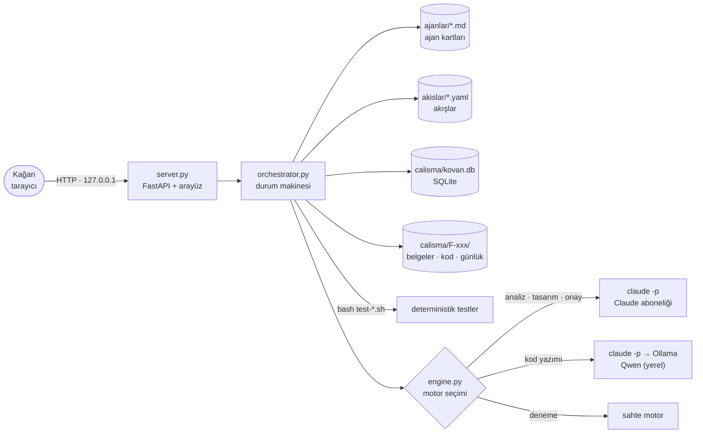
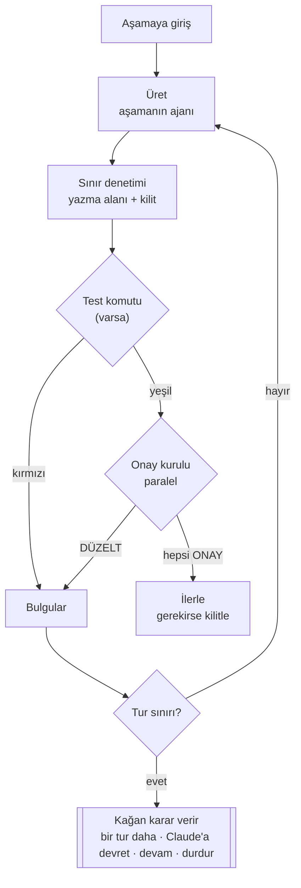
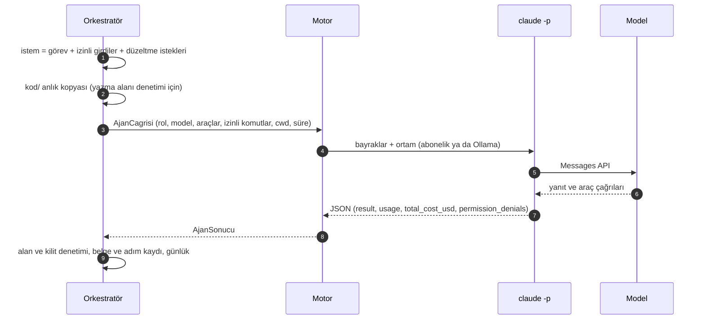
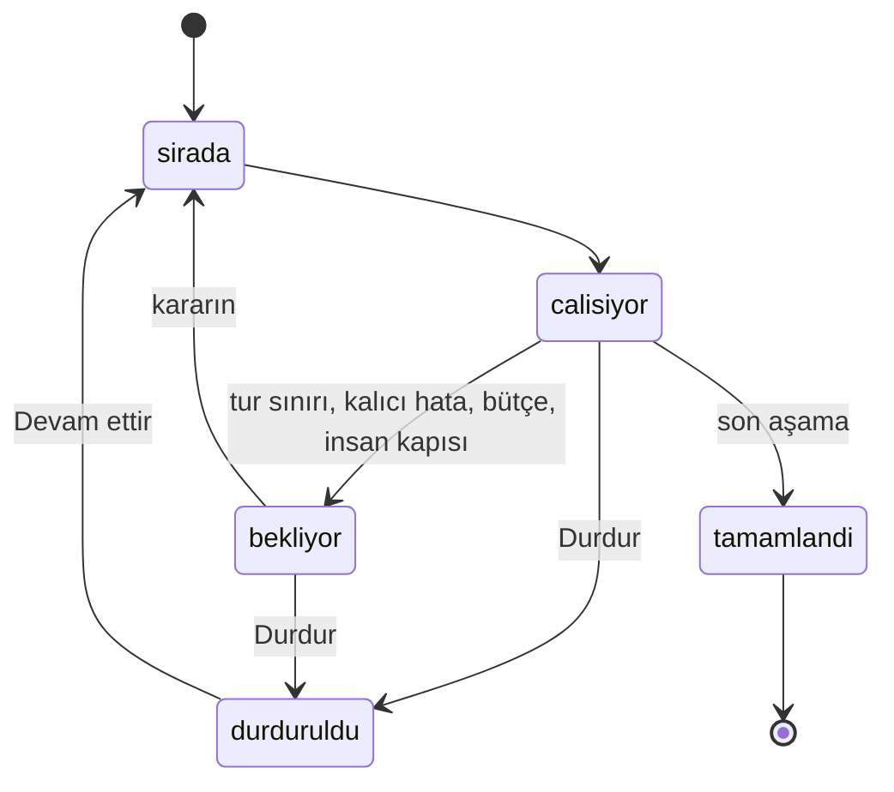
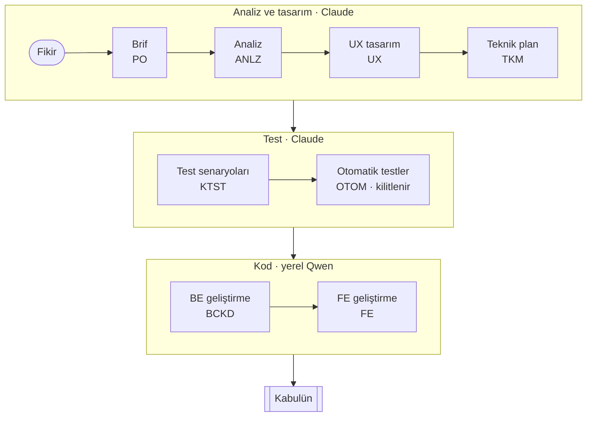

# Kovan · sınırları belli ajanlardan bir yazılım ekibi

Bir fikir yazıyorsun. Ürün Sahibi, İş Analisti, UX Tasarımcı, Mimar, Test Analisti ve Test Otomasyon sırayla kendi işini yapıyor. Kodu BE ve FE yazılımcıları yazıyor. Her aşama bir onay kurulundan geçiyor, testler gerçekten çalıştırılıyor ve son onay sende. Hepsini tarayıcıdan izleyip yönetiyorsun.

**Hibrit çalışır:** kodu yerelde **Qwen** (Ollama) yazar; analiz, tasarım ve onayları **Claude** yapar.
**Qwen yazar, Claude onaylar, testler karar verir.**

---

## İçindekiler
1. [Amaç](#amaç)
2. [Mimari](#mimari)
3. [Hızlı başlangıç](#hızlı-başlangıç)
4. [Hibrit için yerel Qwen kurulumu](#hibrit-için-yerel-qwen-kurulumu)
5. [Ekip ve onay kurulları](#ekip-ve-onay-kurulları)
6. [Karar anları](#karar-anları)
7. [Büyütmek](#büyütmek)
8. [Sorun giderme](#sorun-giderme)
9. [Yol haritası](#yol-haritası)

---

## Amaç

### Problem
Tek bir LLM'e "şunu yap" demenin dört sorunu var:
- **Kapsam kayar:** model istenmeyeni ekler, isteneni atlar.
- **Uydurur:** emin görünen yanlışları kimse yakalamaz.
- **Doğrulama yok:** "çalışıyor" demesi, çalıştığı anlamına gelmez.
- **Görünmez:** hangi karar neden alındı, ne kadar sürdü, neye mal oldu, bilinmez.

### Yaklaşım
Bir yazılım ekibinin rollerini, **sınırları sistemce uygulanan** dar rollü ajanlara bölmek:
- Her ajan yalnızca kendi işini yapar. Yalnızca kendisine verilen belgeleri görür, yalnızca kendi klasörüne yazar.
- Her aşama bir **Üret → Doğrula** döngüsüdür. Doğrulama iki katmanlıdır: LLM'den bağımsız **çalışan testler** ve başka rollerden oluşan bir **onay kurulu**.
- Testler **koddan önce** yazılır ve **kilitlenir**. Yazılımcı testi değiştirip "geçirmiş" gibi yapamaz.
- **Üreten ve onaylayan model farklıdır** (hibritte Qwen yazar, Claude onaylar). Farklı modeller farklı hataları yakalar.
- Tur sınırında, kalıcı hatada ve teslimde **son söz insanda**dır.

### Hedefler
- Kişisel proje fikirlerini uçtan uca, çalışan ve testli koda dönüştürmek.
- Her adımı görünür kılmak: kim, ne zaman, kaçıncı turda, kaç token, ne kadar sürede.
- Maliyeti dengelemek: ağır kodlama yerelde (Qwen), muhakeme ve onay Claude'da.
- Ölçerek büyümek: yeni ajan, ölçülen bir hata türünü yakalamak için eklenir. "Daha çok ajan daha iyidir" varsayımı yok.

### Kapsam dışı
- Çok kullanıcılı ya da internete açık kurulum. Kovan yalnızca `127.0.0.1`'de çalışır.
- Kurumsal kod ve kurum verisi. Kişisel projeler içindir.
- Tam otonomi. İnsan kapısı bilinçli bir tasarım kararıdır.

---

## Mimari

### Genel bakış



Kovan tek bir Python sürecidir. Dış servis, kuyruk ya da veritabanı sunucusu yoktur. Ajanlar `claude -p` (Claude Code headless) alt süreçleri olarak çalışır. Yerel model de **aynı harness**'tan geçer: Claude Code'un araçları, izin kuralları ve çalışma dizini sınırları yerel ajanlar için de aynen geçerlidir. Değişen tek şey, isteklerin Ollama'nın Anthropic uyumlu API'sine gitmesidir.

### Bileşenler

| Modül | Sorumluluk |
|---|---|
| `kovan/orchestrator.py` | Durum makinesi. Aşamaları sırayla yürütür; Üret → Doğrula döngüsü, paralel onay kurulu, yazma alanı ve kilit denetimi, süre/bütçe/tur sınırları, insan kararları, yeniden başlatmada kurtarma |
| `kovan/engine.py` | Motorlar. `ClaudeMotoru` (abonelik), `OllamaMotoru` (aynı harness + yerel model), `DenemeMotoru` (token harcamaz). `claude --help`'ten bayrak tespiti, JSON çözümleme, kalıcı/geçici hata ayrımı |
| `kovan/cards.py` | Ajan kartları: YAML ön bilgi (motor, model, araçlar, izinli komutlar, süre, bütçe) + markdown gövde (sistem promptu) |
| `kovan/pipelines.py` | Akış tanımları ve doğrulaması: girdiler, çıktı, yazma alanı, kilit, doğrulayıcılar, tur sınırı |
| `kovan/store.py` | SQLite deposu: `fikirler` ve `adimlar` tabloları, şema göçü |
| `kovan/server.py` | FastAPI: arayüz, JSON API, ajan çıktılarının yalıtılmış önizlemesi, köken denetimi |
| `ui/index.html` | Bağımlılıksız tek dosya arayüz; 2 saniyede bir yoklar |
| `ajanlar/`, `akislar/` | Ekibin ve sürecin kendisi. Kod değil, yapılandırma |

### Bir aşamanın yaşam döngüsü



- Kırmızı koda onay kurulu çağrılmaz; önce testler yeşile döner.
- Bulgular, üreten ajana bir sonraki turda "Düzeltme istekleri" olarak gider.
- Geri gönderilen bir aşamadan sonraki aşamalar **yeniden yazılmaz**, yalnızca yeniden doğrulanır. Sorun bulunursa normal döngü işler.

### Bir ajan çağrısı



`claude -p`'ye giden başlıca bayraklar: `--output-format json`, `--model`, `--system-prompt` ya da `--append-system-prompt`, `--tools`, `--allowedTools`, `--permission-mode acceptEdits` (yalnızca yazan ajanlarda), `--permission-prompts none`, `--json-schema` (onaylarda), `--max-budget-usd`, `--no-session-persistence`. Kovan, yüklü `claude` sürümünün desteklemediği bayrakları göndermez.

### Bir fikrin durumları



Sunucu kapanırsa yarıda kalan işler bir sonraki açılışta `bekliyor` durumuna alınır ve "kaldığı yerden devam" seçeneğiyle sana sorulur.

### Akışlar



Tam yığın akış yukarıdaki gibi. Standart akışta UX ve FE yok; Mini akış Brif → Otomatik testler → BE → Kabul.

| Akış | Ne için | Aşamalar | Mutlu yolda çağrı |
|---|---|---|---|
| **Mini** | küçük BE işleri, onay kurulu yok | Brif → Otomatik testler → BE → Kabul | 3 ajan + test koşumu |
| **Standart (BE)** | arayüzsüz işler | yukarıdaki akışın UX ve FE'siz hali | 6 üretici + 12 onay |
| **Tam yığın (FE+BE)** | arayüzlü işler | yukarıdaki akış | 8 üretici + 20 onay |

Onay kurulunun bir maliyeti var. Küçük işi tam yığına sokma.

### Sınır modeli: katmanlı savunma

| Katman | Nerede uygulanır | Ne sağlar |
|---|---|---|
| Rol, görev, "yapma" listesi | ajan kartı (prompt) | Ajan kendi işine odaklanır |
| Ne okuyabilir | akıştaki `girdiler` | Ajan yalnızca kendisine verilen belgeleri görür |
| Araçlar | `--tools` | Belge ve onay ajanlarında hiç araç yok |
| Komut izni | `--allowedTools` + `--permission-prompts none` | Yalnızca kartta izinli komutlar; gerisi reddedilir ve "İzin reddi" olarak görünür |
| **Yazma alanı** | çalıştırma öncesi/sonrası karşılaştırma | Ajan kendi klasörü dışına yazarsa değişiklik geri alınır, "sınır ihlali" kaydedilir |
| **Kilit** | SHA-256 + geri alma | Testler ve tasarım onaydan sonra değiştirilemez |
| Doğrulama | `bash test-be.sh` / `test-fe.sh` | Kod gerçekten çalıştırılır; LLM'in "çalışıyor" demesi yetmez |
| Onay kurulu | paralel inceleyenler, JSON şemalı karar | Hepsi ONAY vermeden aşama geçmez |
| Süre, bütçe, tur | orkestratör | Takılan adım durdurulur; sınırda karar insana kalır |
| Önizleme yalıtımı | sandbox CSP | Ajanın yazdığı HTML, Kovan'a senin adına istek atamaz |
| Köken denetimi | sunucu | Başka bir site localhost'taki Kovan'a istek atamaz |

> Sınırlar halüsinasyonu **azaltır**, tek başına **engellemez**. Yakalayan şey doğrulamadır: başka bir modelin incelemesi ve gerçekten çalışan test.

### Veri ve klasörler

```
kovan/
├─ Baslat.command      çift tıkla (macOS)
├─ kovan.yaml          ayarlar: mod, yerel motor, paralel iş, deneme sayısı
├─ ajanlar/            10 ajan kartı
├─ akislar/            mini, standart, tam-yigin
├─ kovan/              Python paketi
├─ ui/index.html       arayüz
└─ calisma/            (git'te yok) fikirlerin çıktıları
   ├─ kovan.db         fikirler + adımlar
   └─ F-001/
      ├─ belgeler/     brif, analiz, plan, senaryolar...  (_surumler/ eski sürümler)
      ├─ incelemeler/  her ONAY / DÜZELT kararı
      ├─ kod/          tasarim/  testler/  backend/  frontend/  test-be.sh  test-fe.sh
      ├─ gunluk/       her çağrının tam istemi, komutu ve ham çıktısı
      └─ .kovan/       kilit kaydı ve çalıştırma öncesi anlık kopya
```

Her ajan çağrısı, test koşumu ve karar `adimlar` tablosunda bir satırdır: aşama, tür, ajan, motor, model, tur, deneme, süre, token, maliyet, sonuç, özet ve ilgili dosya.

### Tasarım kararları

1. **Ajan = markdown kart.** Ekibi büyütmek için kod yazmak gerekmez, kart yazmak yeter.
2. **Sınırın çoğu sistemde.** Prompt ikna eder; araç kısıtı, izin kuralı, yazma alanı denetimi ve kilit zorlar.
3. **Doğrulama LLM'den bağımsız.** Testleri orkestratör çalıştırır; sonuç çıkış kodudur.
4. **Testler koddan önce ve kilitli.** "Bitti"nin tanımı yazılımcıdan önce sabitlenir.
5. **Üreten ≠ onaylayan.** Hibritte kodu Qwen yazar, Claude onaylar. Aynı modelin kendi hatasını görmesi zordur.
6. **Sonsuz döngü yok.** Tur sınırı ve kalıcı hata insana gider. Hibritte "Claude'a devret" bir kaçış kapısıdır.
7. **Geri dönüşte yeniden doğrulama.** Sonraki aşamalar baştan yazılmaz; testler ve kurul tekrar bakar.
8. **Tek makine.** localhost, SQLite, dosya sistemi. Kurulumu `Baslat.command` kadar basit.
9. **Sürüm toleransı.** `claude --help` okunur, desteklenmeyen bayrak gönderilmez.
10. **Abonelik yalıtımı.** Claude ajanlarında `ANTHROPIC_BASE_URL`/`ANTHROPIC_API_KEY` gibi yönlendirme değişkenleri temizlenir. Böylece yanlışlıkla API'ye ya da yerel modele gidilmez.

---

## Hızlı başlangıç

1. Klasörü bir yere aç, ör. `~/Projeler/kovan`.
2. `Baslat.command`'a çift tıkla. İlk seferde paketleri kurar (~1 dk) ve tarayıcıda `http://127.0.0.1:8765` açılır.
   - macOS "doğrulanamadı" derse: **Sistem Ayarları → Gizlilik ve Güvenlik → Yine de Aç**. Ya da Terminal'de: `cd ~/Projeler/kovan && bash Baslat.command`
3. **+ Yeni fikir** → "Örnek: Flora AI paneli" → Akış **Tam yığın** → Mod **Deneme** → Başlat. Token harcamadan bütün ekibi izlersin.
   Küçük bir iş denemek için "Örnek: Flora AI kredisi" (Mini akış).
4. Gerçek iş için mod: **Hibrit** (Ollama kuruluysa) ya da **Hepsi Claude**.

**Gereksinimler:** macOS, Python 3.9+, Claude Code (kurulu ve giriş yapılmış: Terminal'de bir kez `claude`). Hibrit için ayrıca Ollama 0.14+.

---

## Hibrit için yerel Qwen kurulumu

1. [Ollama](https://ollama.com) uygulamasını kur. **0.14 veya üstü** olmalı; Claude Code ile konuşabilmesi bu sürümden geliyor.
2. Ollama **Ayarlar → Context length** değerini **64k** yap. Bu en kritik ayar: bağlam küçük kalırsa ajan saçmalar.
   Terminal'den çalıştırıyorsan: `OLLAMA_CONTEXT_LENGTH=65536 ollama serve`
3. Modeli indir: `ollama pull qwen3-coder:30b`
4. Kovan'ı yeniden başlat. Üst çubukta **qwen-yerel · qwen3-coder:30b hazır** görmelisin.

| Mac belleği | Model (`kovan.yaml` → `motorlar.qwen-yerel.model`) |
|---|---|
| 32 GB | `qwen3-coder:30b` (MoE, hızlı; varsayılan) ya da `qwen3.6:27b` (daha yeni, daha yavaş) |
| 64 GB+ | `qwen3-coder-next` |
| 16 GB | Yerel ajan kodlaması zayıf kalır. **Hepsi Claude** modunu öneririm. |

Ollama değişkenlerini (`ANTHROPIC_BASE_URL` vb.) `~/.zshrc`'ye ya da `~/.claude/settings.json`'a yazma. Kovan bunları yalnızca yerel ajanların çağrısına koyar, Claude ajanları için temizler. `settings.json`'daki değerler ise Kovan'ın ayarını ezer.

---

## Ekip ve onay kurulları

| Ajan | Motor | Üretir | Onay kurullarında |
|---|---|---|---|
| Ürün Sahibi (PO) | Claude | brif | analiz, UX, test senaryoları, BE ve FE kodu |
| İş Analisti (ANLZ) | Claude | analiz | UX, plan, test senaryoları |
| UX Tasarımcı (UX) | Claude | `tasarim/`: akışlar, tıklanabilir prototip, arayüz sözleşmesi | FE kodu |
| Ana Mimar (TKM) | Claude | teknik plan | analiz, BE ve FE kodu |
| Test Analisti (KTST) | Claude | FE + BE test senaryoları | otomatik testler (kapsama) |
| Test Otomasyon (OTOM) | Claude | `testler/`, `test-be.sh`, `test-fe.sh` (sonra kilitlenir) | – |
| Yazılımcı BE (BCKD) | **Qwen (yerel)** | `backend/` | – |
| Yazılımcı FE (FE) | **Qwen (yerel)** | `frontend/` | – |
| Güvenlik (SCRT) | Claude | – | plan, BE ve FE kodu (yalnızca KRİTİK/YÜKSEK için DÜZELT) |
| Mevzuat ve Uyum (UYUM) | Claude | – | analiz, UX, plan, FE kodu |

**Tam yığında onay kurulları:**

| Aşama | Onaylayanlar |
|---|---|
| Analiz | PO + Mimar + Mevzuat |
| UX tasarım | PO + Analist + Mevzuat |
| Teknik plan | Analist + Güvenlik + Mevzuat |
| Test senaryoları | PO + Analist |
| Otomatik testler | Test Analisti |
| BE geliştirme | BE testleri + Mimar + PO + Güvenlik |
| FE geliştirme | FE testleri + Mimar + PO + UX + Güvenlik + Mevzuat |

**Arayüz sözleşmesi:** UX her önemli element için sabit bir `id` belirler. Testler bu kimliklere göre yazılır, FE Yazılımcı aynılarını kullanmak zorundadır. Yerel modelin belirsizlikte kaybolmasını azaltan şey bu.

**Mevzuat ajanı hukuki görüş vermez.** Riskleri işaretler. Madde ya da numara uydurmaması kartında kural olarak yazılı; emin değilse "uzman teyidi gerekir" der.

---

## Karar anları

- **Tur sınırı:** Bir tur daha ver, olduğu gibi kabul et ya da durdur. Hibritte bir seçenek daha var: **Bu aşamayı Claude'a devret**. Qwen tıkandıysa o aşama Claude'la devam eder.
- **Kalıcı hatalar** (oturum yok, limit doldu, Ollama kapalı) tekrar denenmez, doğrudan sana sorulur.
- **Geri gönderme:** Hangi aşamaya döneceğini sen seçersin. O aşama notunla yeniden çalışır; sonraki aşamalar yeniden yazılmaz, yalnızca yeniden doğrulanır.
- **Bütçe:** Fikir bütçesi dolunca durur ve sorar. Abonelikte bu tutar faturalanmaz ama kullanım limitinden yer.

---

## Büyütmek

- **Yeni ajan:** `ajanlar/` içinde bir kartı kopyala, düzenle, Kovan'ı yeniden başlat. Yerelde çalışsın istersen `motor: qwen-yerel` yaz.
- **Ajan başına farklı yerel model:** kartta `yerel_model: qwen3.6:27b` gibi bir satır ekle.
- **Yeni akış:** bir YAML'ı kopyala. Aşama ekle, `dogrulama` altına inceleyen ya da komut ekle, `yazabilir` ile yazma alanını ver.
- **Kural:** Yeni bir ajanı, ölçtüğün bir hata türünü yakalamak için ekle. Her yeni devir bağlam kaybı, süre ve maliyet getirir.

---

## Sorun giderme

| Belirti | Çözüm |
|---|---|
| "qwen-yerel hazır değil: Ollama'ya ulaşılamadı" | Ollama uygulamasını aç |
| "Model indirilmemiş" | `ollama pull qwen3-coder:30b` |
| Qwen saçmalıyor ya da araçları yanlış kullanıyor | Ollama bağlam uzunluğu en az 64k mı? Değilse en sık sebep bu |
| Qwen hep tur sınırına takılıyor | **Bu aşamayı Claude'a devret** ya da kartta `en_fazla_tur`'u artır; daha büyük model dene |
| "claude oturumu açık değil" | Terminal'de bir kez `claude`, giriş, sonra **Tekrar dene** |
| "Kullanım limitine takıldı" | Limit sıfırlanınca **Tekrar dene**. `paralel_fikir: 1` kalsın; küçük işlerde **Mini** kullan |
| FE testleri ilk seferde uzun sürüyor | `test-fe.sh` Playwright tarayıcısını kuruyor olabilir (bir kerelik) |
| "İzin reddi" görüyorsun ve o komut gerçekten gerekli | Kartın `izinli_komutlar` listesine ekle |
| Ajanın ne gördüğünü merak ediyorum | Adımlar tablosunda satıra tıkla, ya da `calisma/F-xxx/gunluk/adim-N.json` |

Maliyet sütunu Claude Code'un tahminidir. Abonelikte faturalanmaz ama kullanım limitinden yer. Yerel adımlarda "yerel" yazar.

---

## Yol haritası

- [ ] Fikir başına git deposu: tur tur diff ve geri alma
- [ ] Deterministik güvenlik taramaları onay kurulundan önce (`bandit`, `semgrep`, `gitleaks`)
- [ ] Qwen Code motoru: Qwen modellerini kendi harness'ında çalıştırma seçeneği
- [ ] Fikrin boyutuna göre akışı öneren triage ajanı
- [ ] İş kalemlerinin (P1, P2...) paralel geliştirilmesi
- [ ] Mod karşılaştırma raporu: aynı fikir için Hibrit ve Hepsi Claude; tur, süre, maliyet
