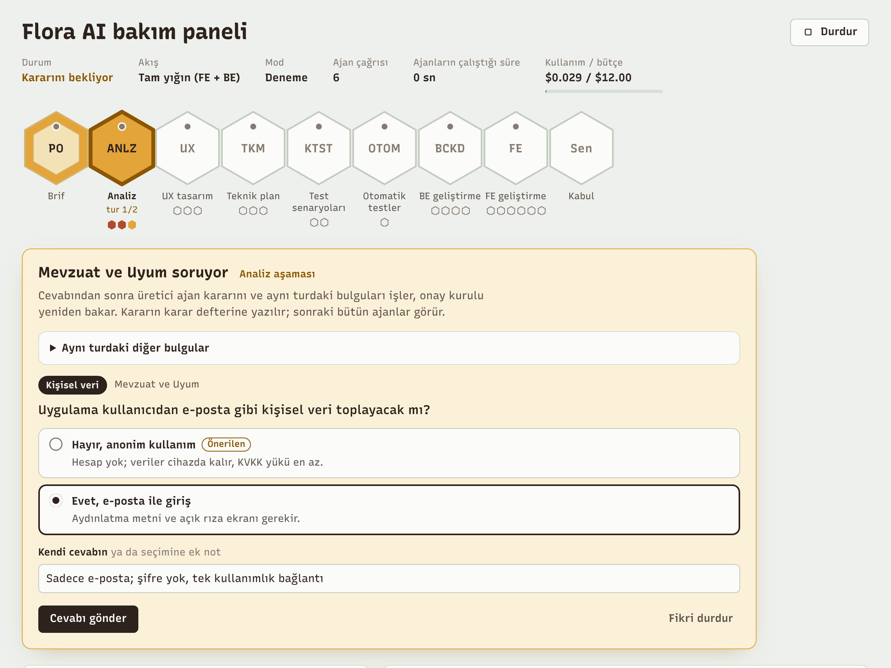
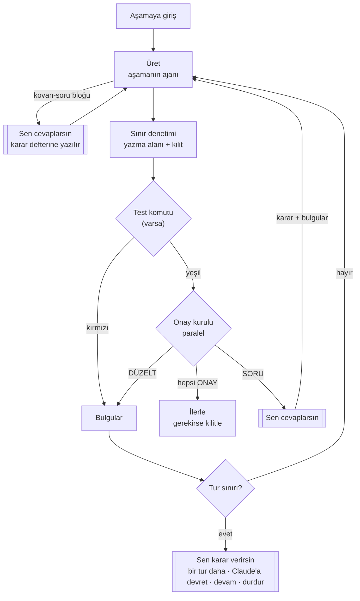
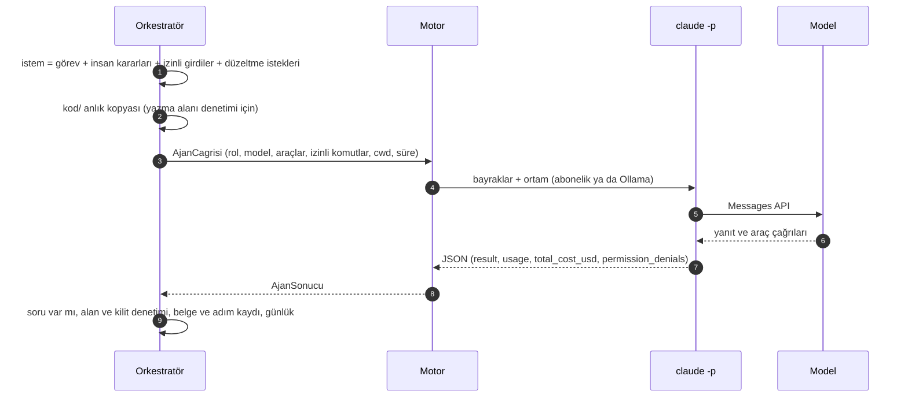
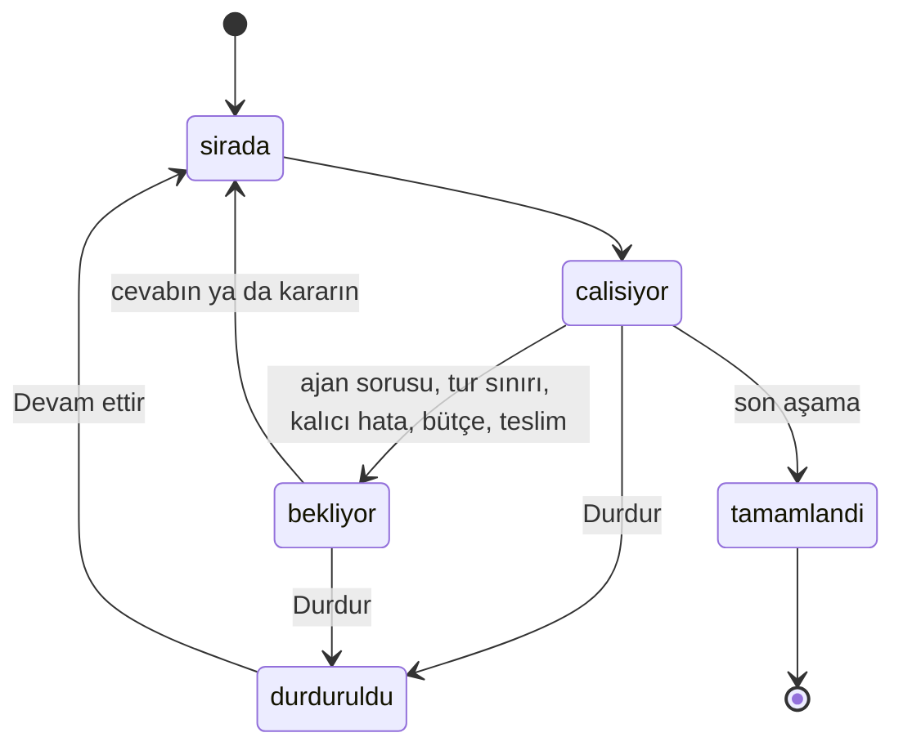
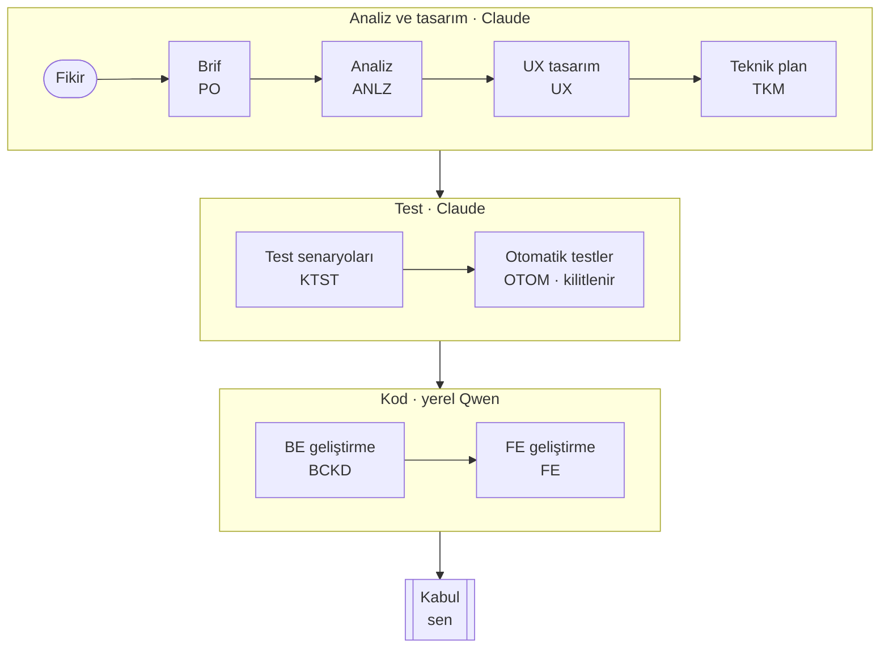
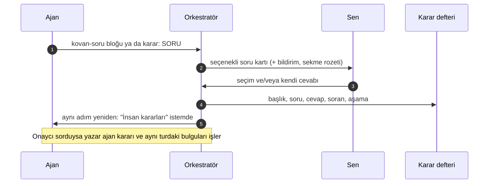
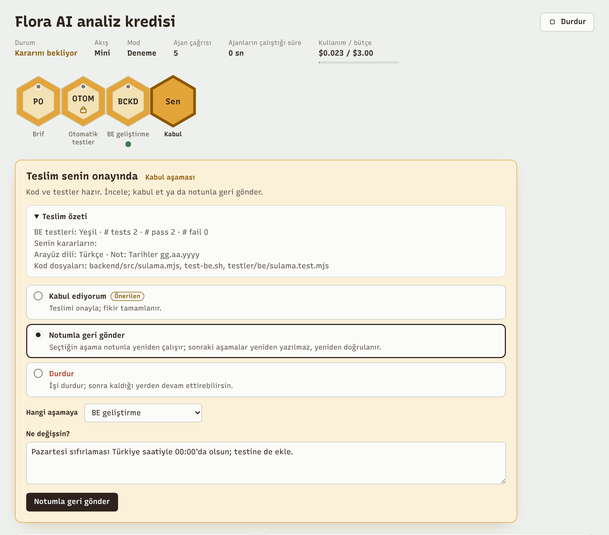

# Kovan · sınırları belli ajanlardan bir yazılım ekibi

Bir fikir yazıyorsun. Ürün Sahibi, İş Analisti, UX Tasarımcı, Mimar, Test Analisti ve Test Otomasyon sırayla kendi işini yapıyor. Kodu BE ve FE yazılımcıları yazıyor. Her aşama bir onay kurulundan geçiyor, testler gerçekten çalıştırılıyor. Ajanlar takıldıkları yerde sana seçenekli soru soruyor; son söz sende. Hepsini tarayıcıdan izleyip yönetiyorsun.

**Hibrit çalışır:** kodu yerelde **Qwen** (Ollama) yazar; analiz, tasarım ve onayları **Claude** yapar.
**Qwen yazar, Claude onaylar, testler karar verir, sen yön verirsin.**



---

## İçindekiler
1. [Amaç](#amaç)
2. [Mimari](#mimari)
3. [İnsan döngüde: sorular ve kararlar](#insan-döngüde-sorular-ve-kararlar)
4. [Hızlı başlangıç](#hızlı-başlangıç)
5. [Hibrit için yerel Qwen kurulumu](#hibrit-için-yerel-qwen-kurulumu)
6. [Ekip ve onay kurulları](#ekip-ve-onay-kurulları)
7. [Üretilen uygulamanın yığını](#üretilen-uygulamanın-yığını)
8. [Büyütmek](#büyütmek)
9. [Kovan'ı geliştirmek](#kovanı-geliştirmek)
10. [Sorun giderme](#sorun-giderme)
11. [Yol haritası](#yol-haritası)

---

## Amaç

### Problem
Tek bir LLM'e "şunu yap" demenin beş sorunu var:
- **Kapsam kayar:** model istenmeyeni ekler, isteneni atlar.
- **Uydurur:** emin görünen yanlışları kimse yakalamaz.
- **Doğrulama yok:** "çalışıyor" demesi, çalıştığı anlamına gelmez.
- **Sormaz:** belirsizlikte sessizce bir varsayım seçer, iş yanlış yöne gider.
- **Görünmez:** hangi karar neden alındı, ne kadar sürdü, neye mal oldu, bilinmez.

### Yaklaşım
Bir yazılım ekibinin rollerini, **sınırları sistemce uygulanan** dar rollü ajanlara bölmek:
- Her ajan yalnızca kendi işini yapar. Yalnızca kendisine verilen belgeleri görür, yalnızca kendi klasörüne yazar.
- Her aşama bir **Üret → Doğrula** döngüsüdür. Doğrulama iki katmanlıdır: LLM'den bağımsız **çalışan testler** ve başka rollerden oluşan bir **onay kurulu**.
- Testler **koddan önce** yazılır ve **kilitlenir**. Yazılımcı testi değiştirip "geçirmiş" gibi yapamaz.
- **Üreten ve onaylayan model farklıdır** (hibritte Qwen yazar, Claude onaylar). Farklı modeller farklı hataları yakalar.
- **İnsan döngüdedir:** yanlış bir varsayım işi boşa çıkaracaksa ajan sana açıklamalı seçeneklerle sorar. Tur sınırında, kalıcı hatada ve teslimde de karar seninle.

### Hedefler
- Kişisel proje fikirlerini uçtan uca, çalışan ve testli koda dönüştürmek.
- Her adımı görünür kılmak: kim, ne zaman, kaçıncı turda, hangi motorda, kaç token, ne kadar sürede.
- Maliyeti dengelemek: ağır kodlama yerelde (Qwen), muhakeme ve onay Claude'da.
- Ölçerek büyümek: yeni ajan, ölçülen bir hata türünü yakalamak için eklenir. "Daha çok ajan daha iyidir" varsayımı yok.

### Kapsam dışı
- Çok kullanıcılı ya da internete açık kurulum. Kovan yalnızca `127.0.0.1`'de çalışır.
- Kurumsal kod ve kurum verisi. Kişisel projeler içindir.
- Tam otonomi. İnsan kapısı bilinçli bir tasarım kararıdır.

---

## Mimari

### Genel bakış


Kovan tek bir Node.js sürecidir (TypeScript, `tsx` ile derlemeden çalışır). Dış servis, kuyruk ya da veritabanı yoktur: her fikrin durumu kendi klasöründe okunabilir JSON dosyalarıdır. Ajanlar `claude -p` (Claude Code headless) alt süreçleri olarak çalışır. Yerel model de **aynı harness**'tan geçer: Claude Code'un araçları, izin kuralları ve çalışma dizini sınırları yerel ajanlar için de aynen geçerlidir. Değişen tek şey, isteklerin Ollama'nın Anthropic uyumlu API'sine gitmesidir.

### Bileşenler

| Dosya | Sorumluluk |
|---|---|
| `sunucu/src/orkestrator.ts` | Durum makinesi. Aşamaları sırayla yürütür; Üret → Doğrula döngüsü, paralel onay kurulu, ajan soruları ve karar defteri, yazma alanı ve kilit denetimi, süre/bütçe/tur sınırları, insan kararları, yeniden başlatmada kurtarma |
| `sunucu/src/motor.ts` | Motorlar. `ClaudeMotoru` (abonelik), `OllamaMotoru` (aynı harness + yerel model), `DenemeMotoru` (token harcamaz). `claude --help`'ten bayrak tespiti, JSON çözümleme, kalıcı/geçici hata ayrımı, soru bloğu ayrıştırma |
| `sunucu/src/sunucu.ts` | Fastify: derlenmiş arayüz, JSON API, ajan çıktılarının yalıtılmış önizlemesi, host ve köken denetimi |
| `sunucu/src/depo.ts` | Fikir ve adım kayıtları: `calisma/F-xxx/.kovan/fikir.json` ve `adimlar.json`, atomik yazım |
| `sunucu/src/kartlar.ts`, `akislar.ts`, `ayarlar.ts` | Ajan kartları, akış tanımları ve doğrulaması, `kovan.yaml` |
| `sunucu/src/tipler.ts` | Sunucu ile arayüzün paylaştığı tipler |
| `arayuz/src/` | Vite + React + TypeScript arayüz: petek şeridi, karar yuvası, zaman çizelgesi, dosyalar, ajanlar, akışlar. Tasarım notları: `arayuz/TASARIM.md` |
| `ajanlar/`, `akislar/` | Ekibin ve sürecin kendisi. Kod değil, yapılandırma |
| `sunucu/test/` | Vitest: uçtan uca akışlar, sınırlar, motorlar (sahte `claude` ve sahte Ollama ile), HTTP güvenliği |

### Bir aşamanın yaşam döngüsü



- Kırmızı koda onay kurulu çağrılmaz; önce testler yeşile döner.
- Bulgular, üreten ajana bir sonraki turda "Düzeltme istekleri" olarak gider.
- Onaycı soru sorduysa, cevabından sonra yazar ajan kararını ve aynı turdaki DÜZELT bulgularını tek turda işler; kurul yeniden bakar.
- Geri gönderilen bir aşamadan sonraki aşamalar **yeniden yazılmaz**, yalnızca yeniden doğrulanır. Sorun bulunursa normal döngü işler.

### Bir ajan çağrısı



`claude -p`'ye giden başlıca bayraklar: `--output-format json`, `--model`, `--system-prompt` ya da `--append-system-prompt`, `--tools`, `--allowedTools`, `--permission-mode acceptEdits` (yalnızca yazan ajanlarda), `--json-schema` (onaylarda), `--max-budget-usd`, `--no-session-persistence`. Kovan, yüklü `claude` sürümünün desteklemediği bayrakları göndermez.

### Bir fikrin durumları



Sunucu kapanırsa yarıda kalan işler bir sonraki açılışta `bekliyor` durumuna alınır ve "Tekrar dene" seçeneğiyle sana sorulur.

### Akışlar



Tam yığın akış yukarıdaki gibi. Standart akışta UX ve FE yok; Mini akış Brif → Otomatik testler → BE → Kabul.

| Akış | Ne için | Aşamalar | Mutlu yolda çağrı |
|---|---|---|---|
| **Mini** | küçük BE işleri, onay kurulu yok | Brif → Otomatik testler → BE → Kabul | 3 ajan + test koşumu |
| **Standart (BE)** | arayüzsüz işler | yukarıdaki akışın UX ve FE'siz hali | 6 üretici + 12 onay |
| **Tam yığın (FE+BE)** | arayüzlü işler | yukarıdaki akış | 8 üretici + 20 onay |

Onay kurulunun bir maliyeti var. Küçük işi tam yığına sokma. Her soru ve düzeltme turu birkaç çağrı ekler.

### Sınır modeli: katmanlı savunma

| Katman | Nerede uygulanır | Ne sağlar |
|---|---|---|
| Rol, görev, "yapma" listesi | ajan kartı (prompt) | Ajan kendi işine odaklanır |
| Ne okuyabilir | akıştaki `girdiler` | Ajan yalnızca kendisine verilen belgeleri ve senin kararlarını görür |
| Araçlar | `--tools` | Belge ve onay ajanlarında hiç araç yok |
| Komut izni | `--allowedTools` | Yalnızca kartta izinli komutlar; gerisi reddedilir ve "İzin reddi" olarak görünür |
| **Yazma alanı** | çalıştırma öncesi/sonrası karşılaştırma | Ajan kendi klasörü dışına yazarsa değişiklik geri alınır, "sınır ihlali" kaydedilir |
| **Kilit** | SHA-256 + geri alma | Testler ve tasarım onaydan sonra değiştirilemez |
| Doğrulama | `bash test-be.sh` / `test-fe.sh` | Kod gerçekten çalıştırılır; LLM'in "çalışıyor" demesi yetmez |
| Onay kurulu | paralel inceleyenler, JSON şemalı karar | Hepsi ONAY vermeden aşama geçmez |
| **Soru sınırı** | orkestratör (`en_fazla_soru_turu`) | Ajan seni darlamaz; hak dolunca varsayımla devam etmesi söylenir |
| Süre, bütçe, tur | orkestratör | Takılan adım durdurulur; sınırda karar sana kalır |
| Önizleme yalıtımı | sandbox CSP | Ajanın yazdığı HTML, Kovan'a senin adına istek atamaz |
| Host ve köken denetimi | sunucu | Başka bir site localhost'taki Kovan'a istek atamaz, DNS rebinding işe yaramaz |

> Sınırlar halüsinasyonu **azaltır**, tek başına **engellemez**. Yakalayan şey doğrulamadır: başka bir modelin incelemesi, gerçekten çalışan test ve senin kararın.

### Veri ve klasörler

```
kovan/
├─ Baslat.command      çift tıkla (macOS)
├─ kovan.yaml          ayarlar: mod, yerel motor, paralel iş, ajan soruları
├─ ajanlar/            10 ajan kartı
├─ akislar/            mini, standart, tam-yigin
├─ sunucu/src/         Node.js + TypeScript sunucu ve orkestratör
├─ sunucu/test/        Vitest testleri
├─ arayuz/             Vite + React + TypeScript arayüz (derlenmiş hali arayuz/dist)
└─ calisma/            (git'te yok) fikirlerin çıktıları
   └─ F-001/
      ├─ belgeler/     brif, analiz, plan, senaryolar, kararlar.md  (_surumler/ eski sürümler)
      ├─ incelemeler/  her ONAY / DÜZELT / SORU kararı
      ├─ kod/          tasarim/  testler/  backend/  frontend/  test-be.sh  test-fe.sh
      ├─ gunluk/       her çağrının tam istemi, komutu ve ham çıktısı
      └─ .kovan/       fikir.json, adimlar.json, kararlar.json, kilit kaydı, anlık kopya
```

Her ajan çağrısı, test koşumu, soru ve karar `adimlar.json`'da bir kayıttır: aşama, tür, ajan, motor, model, tur, deneme, süre, token, maliyet, sonuç, özet ve ilgili dosya.

### Tasarım kararları

1. **Ajan = markdown kart.** Ekibi büyütmek için kod yazmak gerekmez, kart yazmak yeter.
2. **Sınırın çoğu sistemde.** Prompt ikna eder; araç kısıtı, izin kuralı, yazma alanı denetimi ve kilit zorlar.
3. **Doğrulama LLM'den bağımsız.** Testleri orkestratör çalıştırır; sonuç çıkış kodudur.
4. **Testler koddan önce ve kilitli.** "Bitti"nin tanımı yazılımcıdan önce sabitlenir.
5. **Üreten ≠ onaylayan.** Hibritte kodu Qwen yazar, Claude onaylar. Aynı modelin kendi hatasını görmesi zordur.
6. **Sormak varsaymaktan ucuz, ama sınırlı.** Pahalı belirsizlikte ajan sorar; küçük konuda "VARSAYIM:" yazıp devam eder. Cevaplar karar defterinde birikir ve bağlayıcıdır.
7. **Sonsuz döngü yok.** Tur sınırı ve kalıcı hata sana gider. Hibritte "Claude'a devret" bir kaçış kapısıdır.
8. **Geri dönüşte yeniden doğrulama.** Sonraki aşamalar baştan yazılmaz; testler ve kurul tekrar bakar.
9. **Tek makine.** localhost, JSON dosyaları, dosya sistemi. Kurulumu `Baslat.command` kadar basit.
10. **Sürüm toleransı.** `claude --help` okunur, desteklenmeyen bayrak gönderilmez.
11. **Abonelik yalıtımı.** Claude ajanlarında `ANTHROPIC_BASE_URL`/`ANTHROPIC_API_KEY` gibi yönlendirme değişkenleri temizlenir. Böylece yanlışlıkla API'ye ya da yerel modele gidilmez.

---

## İnsan döngüde: sorular ve kararlar

Ajan bir karar veremediğinde ve yanlış bir varsayım işi boşa çıkaracaksa durur ve sana sorar. Soru her zaman aynı biçimde gelir:

- kısa bir **başlık** (ör. "Kişisel veri") ve tek başına anlaşılır **net bir soru**,
- **2-4 seçenek**, her birinin altında seçilirse ne olacağını anlatan bir açıklama,
- ajanın **önerdiği seçenek ilk sırada**, "Önerilen" rozetiyle,
- her zaman **kendi cevabını** yazabileceğin ya da seçimine not ekleyebileceğin bir alan,
- birden çok seçenek seçilebilecekse çoklu seçim.



**İki kaynak:**
- **Üreten ajan**, işe başlamadan ya da iş sırasında sorar. Örnek: Ürün Sahibi brifi yazmadan önce arayüz dilini sorar.
- **Onaycı**, inceleme sırasında `"karar": "SORU"` verir. Örnek: Mevzuat, analizi incelerken kişisel veri toplanıp toplanmayacağını sorar.

**Karar defteri:** Cevapların `belgeler/kararlar.md` ve `.kovan/kararlar.json`'a yazılır. Sonraki bütün ajanların isteminde "İnsan kararları" bölümü olarak yer alır; ortak kurallar bunları bağlayıcı sayar. Arayüzde "Kararların" sekmesinde görünür, teslim özetine de girer.

**Sistem kararları** aynı kart düzeniyle gelir:

| Durum | Seçenekler (önerilen ilk) |
|---|---|
| Teslim (insan kapısı) | Kabul ediyorum · Notumla geri gönder (hangi aşamaya) · Durdur |
| Tur sınırı | Bir tur daha (hibritte yerel aşamada önce: Bu aşamayı Claude'a devret) · Olduğu gibi kabul et · Durdur |
| Kalıcı hata | Tekrar dene · Claude'a devret (yerel aşamada) · Bu aşamayı atla · Durdur |
| Bütçe doldu | Bütçeyi artır ve devam et · Durdur |
| Yarıda kalan iş | Tekrar dene · Durdur |



**Seni darlamasınlar diye:** bir aşamada en fazla `en_fazla_soru_turu` (varsayılan 2) soru turu. Hak dolunca ajanlara "VARSAYIM yaz, devam et" denir. Soruları tamamen kapatmak için `kovan.yaml`'da `ajan_sorulari: false`.

**Haberin olsun diye:** bir fikir seni beklediğinde sekme başlığı "(N) Kovan" olur; üst çubuktaki **Bildirim al** ile sekme arka plandayken masaüstü bildirimi gelir.

---

## Hızlı başlangıç

1. Klasörü bir yere aç, ör. `~/Projeler/kovan`.
2. `Baslat.command`'a çift tıkla. İlk seferde npm paketlerini kurar ve arayüzü derler (~1 dk); sonra tarayıcıda `http://127.0.0.1:8765` açılır.
   - macOS "doğrulanamadı" derse: **Sistem Ayarları → Gizlilik ve Güvenlik → Yine de Aç**. Ya da Terminal'de: `cd ~/Projeler/kovan && bash Baslat.command`
3. **Yeni fikir** → "Örnekle doldur: Flora AI bakım paneli" → Akış **Tam yığın** → Mod **Deneme** → **Fikri başlat**. Token harcamadan bütün ekibi, soruları ve kararları görürsün.
   Küçük bir iş denemek için "Flora AI analiz kredisi" (Mini akış).
4. Gerçek iş için mod: **Hibrit** (Ollama kuruluysa) ya da **Hepsi Claude**.

**Gereksinimler:** macOS, **Node.js 20.19+ ya da 22.12+** (LTS önerilir), Claude Code (kurulu ve giriş yapılmış: Terminal'de bir kez `claude`). Hibrit için ayrıca Ollama 0.14+.

Terminal'den: `npm install`, `npm run build`, `npm start` (deneme modu varsayılan olsun: `npm run deneme`).

---

## Hibrit için yerel Qwen kurulumu

1. [Ollama](https://ollama.com) uygulamasını kur. **0.14 veya üstü** olmalı; Claude Code ile konuşabilmesi bu sürümden geliyor.
2. Ollama **Ayarlar → Context length** değerini **64k** yap. Bu en kritik ayar: bağlam küçük kalırsa ajan saçmalar.
   Terminal'den çalıştırıyorsan: `OLLAMA_CONTEXT_LENGTH=65536 ollama serve`
3. Modeli indir: `ollama pull qwen3-coder:30b`
4. Kovan'ı yeniden başlat. Üst çubukta **Yerel: hazır** görmelisin.

| Mac belleği | Model (`kovan.yaml` → `motorlar.qwen-yerel.model`) |
|---|---|
| 32 GB | `qwen3-coder:30b` (MoE, hızlı; varsayılan) ya da `qwen3.6:27b` (daha yeni, daha yavaş) |
| 64 GB+ | `qwen3-coder-next` |
| 16 GB | Yerel ajan kodlaması zayıf kalır. **Hepsi Claude** modunu öneririm. |

Ollama değişkenlerini (`ANTHROPIC_BASE_URL` vb.) `~/.zshrc`'ye ya da `~/.claude/settings.json`'a yazma. Kovan bunları yalnızca yerel ajanların çağrısına koyar, Claude ajanları için temizler. `settings.json`'daki değerler ise Kovan'ın ayarını ezer.

---

## Ekip ve onay kurulları

| Ajan | Motor | Üretir | Onay kurullarında |
|---|---|---|---|
| Ürün Sahibi (PO) | Claude | brif | analiz, UX, test senaryoları, BE ve FE kodu |
| İş Analisti (ANLZ) | Claude | analiz | UX, plan, test senaryoları |
| UX Tasarımcı (UX) | Claude | `tasarim/`: akışlar, tıklanabilir prototip, arayüz sözleşmesi | FE kodu |
| Ana Mimar (TKM) | Claude | teknik plan | analiz, BE ve FE kodu |
| Test Analisti (KTST) | Claude | FE + BE test senaryoları | otomatik testler (kapsama) |
| Test Otomasyon (OTOM) | Claude | `testler/`, `test-be.sh`, `test-fe.sh` (sonra kilitlenir) | – |
| Yazılımcı BE (BCKD) | **Qwen (yerel)** | `backend/` | – |
| Yazılımcı FE (FE) | **Qwen (yerel)** | `frontend/` | – |
| Güvenlik (SCRT) | Claude | – | plan, BE ve FE kodu (yalnızca KRİTİK/YÜKSEK için DÜZELT) |
| Mevzuat ve Uyum (UYUM) | Claude | – | analiz, UX, plan, FE kodu |

**Tam yığında onay kurulları:**

| Aşama | Onaylayanlar |
|---|---|
| Analiz | PO + Mimar + Mevzuat |
| UX tasarım | PO + Analist + Mevzuat |
| Teknik plan | Analist + Güvenlik + Mevzuat |
| Test senaryoları | PO + Analist |
| Otomatik testler | Test Analisti |
| BE geliştirme | BE testleri + Mimar + PO + Güvenlik |
| FE geliştirme | FE testleri + Mimar + PO + UX + Güvenlik + Mevzuat |

**Arayüz sözleşmesi:** UX her önemli element için sabit bir `id` belirler. Playwright testleri bu kimliklere göre yazılır, FE Yazılımcı aynılarını JSX'te kullanmak zorundadır. Yerel modelin belirsizlikte kaybolmasını azaltan şey bu.

**Mevzuat ajanı hukuki görüş vermez.** Riskleri işaretler, kararı ürün sahibine (sana) bırakması gereken yerde sorar. Madde ya da numara uydurmaması kartında kural olarak yazılı; emin değilse "uzman teyidi gerekir" der.

---

## Üretilen uygulamanın yığını

Fikir ya da senin kararların başka bir şey söylemiyorsa ajanlar şu yığınla çalışır:

| Katman | Teknoloji | Klasör | Kim yazar |
|---|---|---|---|
| Frontend | Vite + React + TypeScript (`base: "./"`, önizleme alt yoldan açılır) | `kod/frontend/` | Yazılımcı FE |
| Backend | Node.js 20+ + TypeScript (ESM); iş mantığı saf fonksiyonlarda | `kod/backend/` | Yazılımcı BE |
| BE testleri | Vitest | `kod/testler/be/*.test.ts` + `test-be.sh` | Test Otomasyon (kilitli) |
| FE testleri | Playwright (chromium, `vite preview` üzerinde) | `kod/testler/fe/*.spec.ts` + `test-fe.sh` | Test Otomasyon (kilitli) |
| Tasarım | bağımlılıksız tıklanabilir HTML prototip | `kod/tasarim/` | UX (kilitli) |

- Ajanlar npm'i her zaman kendi klasörleri için `--prefix` ile çalıştırır (`npm --prefix backend install`). İzinli komutlar kartlarda bu biçimde tanımlı; gerisi reddedilir.
- `kod/package.json` Kovan'ın koyduğu boş bir köktür: yanlışlıkla `kod/` içinde çıplak `npm install` çalışırsa npm üst klasöre, Kovan'ın kendi `package.json`'ına çıkmaz.
- İlk test koşumunda npm paketleri ve Playwright'ın chromium'u iner; test süre sınırları buna göre geniş tutuldu.
- Arayüzde **UX prototipi** ve **Frontend (build)** önizleme düğmeleri, sandbox'ta yeni sekmede açılır.

---

## Büyütmek

- **Yeni ajan:** `ajanlar/` içinde bir kartı kopyala, düzenle, Kovan'ı yeniden başlat. Yerelde çalışsın istersen `motor: qwen-yerel` yaz. Ne zaman soru soracağını kartın "Ne zaman insana sorarsın" bölümünde anlat.
- **Ajan başına farklı yerel model:** kartta `yerel_model: qwen3.6:27b` gibi bir satır ekle.
- **Yeni akış:** bir YAML'ı kopyala. Aşama ekle, `dogrulama` altına inceleyen ya da komut ekle, `yazabilir` ile yazma alanını ver.
- **Kural:** Yeni bir ajanı, ölçtüğün bir hata türünü yakalamak için ekle. Her yeni devir bağlam kaybı, süre ve maliyet getirir.

---

## Kovan'ı geliştirmek

| Komut | Ne yapar |
|---|---|
| `npm start` | Sunucuyu başlatır (`arayuz/dist`'i sunar) |
| `npm run deneme` | Aynısı; yeni fikirlerde varsayılan mod deneme |
| `npm run gelistir` | Vite geliştirme sunucusu (5173), API istekleri çalışan Kovan'a (8765) gider; arayüzde anında yenileme |
| `npm run build` | Arayüzü `arayuz/dist`'e derler |
| `npm test` | Vitest: akışlar, sınırlar, motorlar, HTTP güvenliği |
| `npm run typecheck` | Sunucu ve arayüz için TypeScript denetimi |

Testler gerçek `claude`'u çağırmaz: `sunucu/test/yardimci/sahte-claude.mjs` gerçek CLI'ın JSON çıktısını taklit eder, yerel motor testleri küçük bir sahte Ollama sunucusuyla koşar.

---

## Sorun giderme

| Belirti | Çözüm |
|---|---|
| "Node.js eski" | [nodejs.org](https://nodejs.org)'dan LTS sürümünü (22+) kur |
| "Paket kurulumu başarısız" | İnternet bağlantını kontrol et; Terminal'de `npm install` çalıştırıp hatayı gör |
| "Port 8765 kullanımda" | Kovan zaten açık olabilir; değilse `kovan.yaml`'da `port`'u değiştir |
| "Yerel hazır değil: Ollama'ya ulaşılamadı" | Ollama uygulamasını aç |
| "Model indirilmemiş" | `ollama pull qwen3-coder:30b` |
| Qwen saçmalıyor ya da araçları yanlış kullanıyor | Ollama bağlam uzunluğu en az 64k mı? Değilse en sık sebep bu |
| Qwen hep tur sınırına takılıyor | **Bu aşamayı Claude'a devret** ya da akışta `en_fazla_tur`'u artır; daha büyük model dene |
| "claude oturumu açık değil" | Terminal'de bir kez `claude`, giriş, sonra **Tekrar dene** |
| "Kullanım limitine takıldı" | Limit sıfırlanınca **Tekrar dene**. `paralel_fikir: 1` kalsın; küçük işlerde **Mini** kullan |
| Ajanlar çok soru soruyor | `en_fazla_soru_turu`'nu düşür ya da `ajan_sorulari: false` yap |
| FE testleri ilk seferde uzun sürüyor | `test-fe.sh` Playwright'ın chromium'unu kuruyor (bir kerelik) |
| "İzin reddi" görüyorsun ve o komut gerçekten gerekli | Kartın `izinli_komutlar` listesine ekle |
| Ajanın ne gördüğünü merak ediyorum | Zaman çizelgesinde adıma tıkla, ya da `calisma/F-xxx/gunluk/adim-N.json` |

Kullanım sütunu Claude Code'un tahminidir. Abonelikte faturalanmaz ama kullanım limitinden yer. Yerel adımlarda sıfırdır.

---

## Yol haritası

- [x] Ajanlar takıldıkları yerde seçenekli soru sorar; karar defteri
- [x] Vite + React arayüz, Node.js + TypeScript sunucu
- [ ] Fikir başına git deposu: tur tur diff ve geri alma
- [ ] Deterministik güvenlik taramaları onay kurulundan önce (`npm audit`, `semgrep`, `gitleaks`)
- [ ] Qwen Code motoru: Qwen modellerini kendi harness'ında çalıştırma seçeneği
- [ ] Fikrin boyutuna göre akışı öneren triage ajanı
- [ ] İş kalemlerinin (P1, P2...) paralel geliştirilmesi
- [ ] Mod karşılaştırma raporu: aynı fikir için Hibrit ve Hepsi Claude; tur, süre, maliyet
