# Kovan · sınırları belli ajanlardan bir yazılım ekibi

Bir fikir yazıyorsun. Kod yazılmadan önce ekip derin planlama yapıyor: Ürün Sahibi kapsamı, İş Analisti analizi, UX Tasarımcı prototipi, Mimar teknik planı çıkarıyor; Proje Yöneticisi işi sıralı iş kalemlerine (P1, P2...) bölüyor; Test Analisti senaryoları, Test Otomasyon test altyapısını hazırlıyor. Sonra her kalem önce kendi kabul testiyle başlıyor, testler kilitleniyor, kodu BE ya da FE yazılımcısı ancak o zaman yazıyor. Her aşama bir onay kurulundan geçiyor, testler gerçekten çalıştırılıyor.

Ajanlar takıldıklarında **önce kendi aralarında oy veriyor**; oybirliği çıkarsa sana sorulmuyor. Anlaşamadıklarında ya da karar para, hukuki risk gibi senin vermen gereken türdense sana seçenekli soru geliyor, kimin neyi seçtiğiyle birlikte. Teslimden sonra Ürün Sahibi gelişim önerileri getiriyor; her birini sana "olmalı mı?" diye soruyor, kabul ettiklerinle yeni sürüm başlıyor. Hepsini tarayıcıdan izleyip yönetiyorsun.

Sıfırdan bir ürün yerine **var olan bir sistemi de yeniden yazdırabilirsin (replatform)**: eski kodu ve analiz dokümanını verirsin; ekip önce sistemin bugün gerçekte ne yaptığını koda atıflarla çıkarır, doküman ile kod arasındaki farkları karara bağlar (anlaşamazsa sana sorar), sonra temiz bir mimariyle ve eski sistemin çıktısıyla karşılaştırarak yeniden yazar. Çıktı, kendi sistemine entegre edeceğin kod ve bir entegrasyon kılavuzudur.

Her şeyin tepesinde **Büyük Birader** izler: her aşamanın sonunda işin tamamına bakar, kapsamdan sapmayı ve kararlarla çelişkiyi yakalarsa aşamayı veto eder. Sonra **senin kapın** gelir: o aşamada alınan kararlar madde madde önüne düşer; onaylar ya da değiştirirsin, mimari seçenekler arasından sen seçersin, emin olamadığın yerde ajana soru sorarsın.

Ürün teslim edildikten sonra da iş bitmez: **var olan bir projede hata düzeltme, yeni özellik ya da entegrasyon** için projenin klasörünü verir, isteğini yazarsın. Kovan projeyi okur, işin türünü ve boyutunu önerir; sen onaylarsın. Küçük işte önce hatayı yakalayan test yazılır, sonra düzeltme; büyük işte planlama derinleşir. Projene dokunulmaz, sonuç bir yama dosyasıdır.

**Hibrit çalışır:** kodu yerelde **Qwen** (Ollama) yazar; analiz, tasarım ve onayları **Claude** yapar. Kod makineden çıkmamalıysa **Hepsi yerel** modu bütün ajanları yerel modelde çalıştırır. Kurumun kendi LLM'i varsa (OpenAI uyumlu bir API ve bir anahtar) bütün ajanlar ona bağlanır; adres, anahtarın yeri ve ajan ayarları repo dışındaki bir ayar dosyasından gelir, Claude Code da gerekmez.
**Qwen yazar, Claude onaylar, testler karar verir, sen yön verirsin.**


---

## İçindekiler
1. [Amaç](#amaç)
2. [Mimari](#mimari)
3. [Kararlar: önce ekip, gerekirse sen](#kararlar-önce-ekip-gerekirse-sen)
4. [Büyük Birader ve onay kapıları](#büyük-birader-ve-onay-kapıları)
5. [Derin planlama ve iş kalemleri](#derin-planlama-ve-iş-kalemleri)
6. [Gelişim önerileri ve yeni sürüm](#gelişim-önerileri-ve-yeni-sürüm)
7. [Replatform: mevcut sistemi yeniden yazmak](#replatform-mevcut-sistemi-yeniden-yazmak)
8. [Mevcut proje üzerinde iş: hata, özellik, entegrasyon](#mevcut-proje-üzerinde-iş-hata-özellik-entegrasyon)
9. [Hızlı başlangıç](#hızlı-başlangıç)
10. [Hibrit için yerel Qwen kurulumu](#hibrit-için-yerel-qwen-kurulumu)
11. [Kurum içi LLM ile çalıştırmak](#kurum-içi-llm-ile-çalıştırmak)
12. [Ekip ve onay kurulları](#ekip-ve-onay-kurulları)
13. [Üretilen uygulamanın yığını](#üretilen-uygulamanın-yığını)
14. [Büyütmek](#büyütmek)
15. [Kovan'ı geliştirmek](#kovanı-geliştirmek)
16. [Sorun giderme](#sorun-giderme)
17. [Yol haritası](#yol-haritası)

---

## Amaç

### Problem
Tek bir LLM'e "şunu yap" demenin beş sorunu var:
- **Kapsam kayar:** model istenmeyeni ekler, isteneni atlar.
- **Uydurur:** emin görünen yanlışları kimse yakalamaz.
- **Doğrulama yok:** "çalışıyor" demesi, çalıştığı anlamına gelmez.
- **Sormaz:** belirsizlikte sessizce bir varsayım seçer, iş yanlış yöne gider.
- **Görünmez:** hangi karar neden alındı, ne kadar sürdü, neye mal oldu, bilinmez.

### Yaklaşım
Bir yazılım ekibinin rollerini, **sınırları sistemce uygulanan** dar rollü ajanlara bölmek:
- Her ajan yalnızca kendi işini yapar. Yalnızca kendisine verilen belgeleri görür, yalnızca kendi klasörüne yazar.
- Her aşama bir **Üret → Doğrula** döngüsüdür. Doğrulama iki katmanlıdır: LLM'den bağımsız **çalışan testler** ve başka rollerden oluşan bir **onay kurulu**.
- Testler **koddan önce** yazılır ve **kilitlenir**. Yazılımcı testi değiştirip "geçirmiş" gibi yapamaz.
- **Üreten ve onaylayan model farklıdır** (hibritte Qwen yazar, Claude onaylar). Farklı modeller farklı hataları yakalar.
- **Önce plan, sonra kod:** kapsam, analiz, teknik plan ve teslim planı onaylanmadan kod yazılmaz; iş küçük kalemlere bölünür, her kalem kendi kabul testiyle başlar.
- **Önce ekip, sonra sen:** yanlış bir varsayım işi boşa çıkaracaksa ajan soru sorar; soru önce ekipte oylanır, anlaşamazlarsa açıklamalı seçeneklerle sana gelir. Para ve hukuki risk gibi kararlar doğrudan sende. Tur sınırında, kalıcı hatada ve teslimde de karar seninle.

### Hedefler
- Kişisel proje fikirlerini uçtan uca, çalışan ve testli koda dönüştürmek.
- Var olan bir sistemi anlayıp temiz, testli ve korunan kurallarda eskisiyle eşdeğer biçimde yeniden yazmak (replatform).
- Teslimden sonraki hayatı da taşımak: var olan bir projede hata, yeni özellik ve entegrasyon işlerini, işin boyutuna uygun bir yoldan, projeye dokunmadan yapmak.
- Her adımı görünür kılmak: kim, ne zaman, kaçıncı turda, hangi motorda, kaç token, ne kadar sürede.
- Maliyeti dengelemek: ağır kodlama yerelde (Qwen), muhakeme ve onay Claude'da.
- Ölçerek büyümek: yeni ajan, ölçülen bir hata türünü yakalamak için eklenir. "Daha çok ajan daha iyidir" varsayımı yok.

### Kapsam dışı
- Çok kullanıcılı ya da internete açık kurulum. Kovan yalnızca `127.0.0.1`'de çalışır.
- Kurum içi kodu kurumunun izin vermediği biçimde işlemek. Kodun nereye gittiğini mod belirler: Hepsi yerel'de bu makinede kalır, Hibrit ve Hepsi Claude'da Claude'a gider (bkz. [Gizlilik](#gizlilik-hangi-modda-ne-makineden-çıkar)).
- Tam otonomi. İnsan kapısı bilinçli bir tasarım kararıdır.

---

## Mimari

### Genel bakış

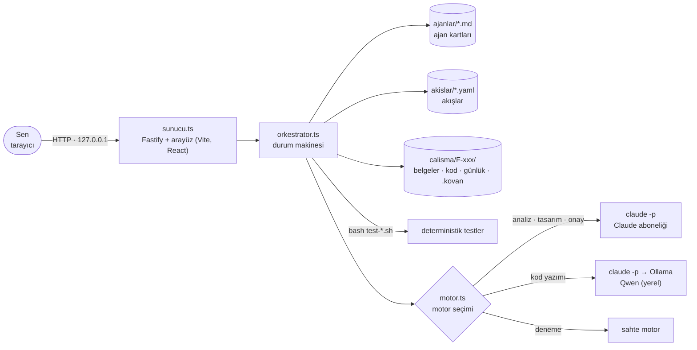

Kovan tek bir Node.js sürecidir (TypeScript, `tsx` ile derlemeden çalışır). Dış servis, kuyruk ya da veritabanı yoktur: her fikrin durumu kendi klasöründe okunabilir JSON dosyalarıdır. Ajanlar `claude -p` (Claude Code headless) alt süreçleri olarak çalışır. Yerel model de **aynı harness**'tan geçer: Claude Code'un araçları, izin kuralları ve çalışma dizini sınırları yerel ajanlar için de aynen geçerlidir. Değişen tek şey, isteklerin Ollama'nın Anthropic uyumlu API'sine gitmesidir.

### Bileşenler

| Dosya | Sorumluluk |
|---|---|
| `sunucu/src/orkestrator.ts` | Durum makinesi. Aşamaları sırayla yürütür; Üret → Doğrula döngüsü, paralel onay kurulu, ortak karar (oylama), ajan soruları ve karar defteri, iş kalemlerinin açılması, gelişim önerileri ve yeni sürüm, yazma alanı ve kilit denetimi, süre/bütçe/tur sınırları, yeniden başlatmada kurtarma |
| `sunucu/src/uyumlu.ts`, `sunucu/src/ajan/` | OpenAI uyumlu motor (kurum içi LLM) ve Kovan'ın kendi ajan döngüsü: araçlar (Read, Write, Edit, MultiEdit, Glob, Grep, Bash), yol hapsi, komut izinleri, Qwen'in metin biçimindeki araç çağrıları; her çağrı ayrı süreçte |
| `sunucu/src/kaynak.ts` | Replatform: mevcut sistemin kaynaklarını içe alır (kopya, atlananlar, Word → HTML, Windows-1254/UTF-16 → UTF-8, zip, sınırlar), kaynak envanteri, kod atıfları denetimi |
| `sunucu/src/plan.ts` | `kovan-plan` ve `kovan-gelisim` bloklarını okur ve denetler; kalem şablonunu her kalem için somut aşamalara açar |
| `sunucu/src/motor.ts` | Motorlar. `ClaudeMotoru` (abonelik), `OllamaMotoru` (aynı harness + yerel model), `DenemeMotoru` (token harcamaz). `claude --help`'ten bayrak tespiti, JSON çözümleme, kalıcı/geçici hata ayrımı, soru bloğu ayrıştırma |
| `sunucu/src/sunucu.ts` | Fastify: derlenmiş arayüz, JSON API, ajan çıktılarının yalıtılmış önizlemesi, host ve köken denetimi |
| `sunucu/src/depo.ts` | Fikir ve adım kayıtları: `calisma/F-xxx/.kovan/fikir.json` ve `adimlar.json`, atomik yazım |
| `sunucu/src/kartlar.ts`, `akislar.ts`, `ayarlar.ts` | Ajan kartları, akış tanımları ve doğrulaması, `kovan.yaml` |
| `sunucu/src/tipler.ts` | Sunucu ile arayüzün paylaştığı tipler |
| `arayuz/src/` | Vite + React + TypeScript arayüz: petek şeridi, karar yuvası, zaman çizelgesi, dosyalar, ajanlar, akışlar. Tasarım notları: `arayuz/TASARIM.md` |
| `ajanlar/`, `akislar/` | Ekibin ve sürecin kendisi. Kod değil, yapılandırma |
| `sunucu/test/` | Vitest: uçtan uca akışlar, sınırlar, motorlar (sahte `claude` ve sahte Ollama ile), HTTP güvenliği |

### Bir aşamanın yaşam döngüsü

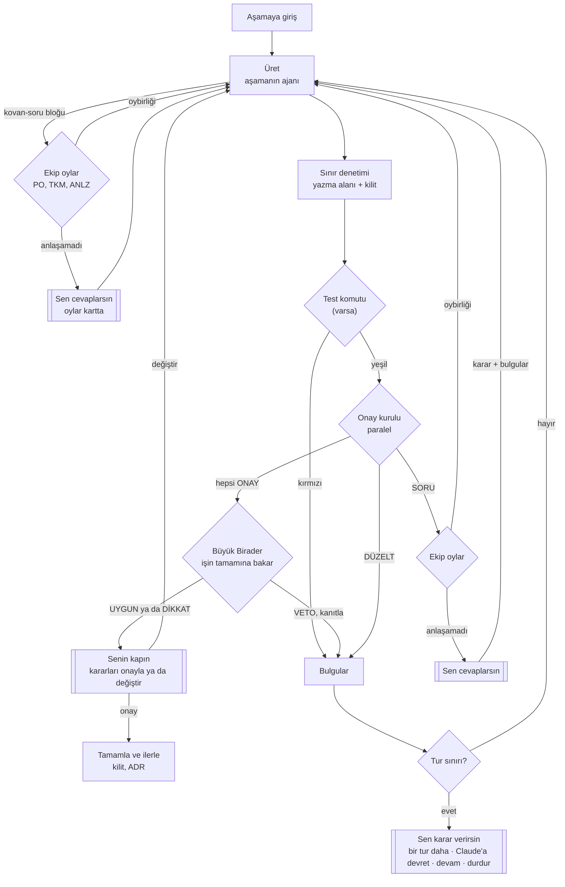

- Kırmızı koda onay kurulu çağrılmaz; önce testler yeşile döner.
- Onay kurulu geçirdikten sonra **Büyük Birader** bakar, sonra (o aşamada kapı açıksa) **karar sana gelir**; kilitler ve mimari karar kayıtları ancak senin onayından sonra yazılır. Ayrıntı: [Büyük Birader ve onay kapıları](#büyük-birader-ve-onay-kapıları).
- Bulgular, üreten ajana bir sonraki turda "Düzeltme istekleri" olarak gider; önceki çıktısı da yanında gider, belgeyi baştan yazmaz.
- **Belge bütünlüğü.** Revizyonda yeni belge öncekinin tamamı olmalı. Önceki sürümdeki bir kimlik (E5, H2, K3, FARK-1...) yeni sürümde yoksa ya da belge yarıdan fazla kısaldıysa, sistem belgeyi onay kuruluna göndermeden geri çevirir ve önceki sürümü yeniden yürürlüğe koyar. Bir kural bilerek kaldırılıyorsa kimliği "Kaldırılanlar" bölümünde yazılır.
- **Sorular sana anlaşılır gelir.** Ajanlara, soruyu belgeyi görmemiş birine sorar gibi yazmaları söylenir: E18, H1 gibi kimlikler tek başına kullanılmaz, dosya ve satır numarası soruya girmez, somut bir örnek verilir.
- **Onay korunur (token tasarrufu).** Revizyon turunda yalnızca düzeltme isteyen onaycılar yeniden bakar; önceki turda ONAY veren bakmaz, zaman çizelgesine "Onay korundu" düşer. Testler ve sistem denetimleri (atıf, plan, ADR) her turda koşar. Aşamaya geri gönderilince ya da aşama yeniden doğrulanınca herkes yeniden bakar. Kapatmak için `kovan.yaml`'da `onayi_koru: false`.
- Onaycı soru sorduysa, cevabından sonra yazar ajan kararını ve aynı turdaki DÜZELT bulgularını tek turda işler; kurul yeniden bakar.
- Geri gönderilen bir aşamadan sonraki aşamalar **yeniden yazılmaz**, yalnızca yeniden doğrulanır. Sorun bulunursa normal döngü işler.

### Bir ajan çağrısı

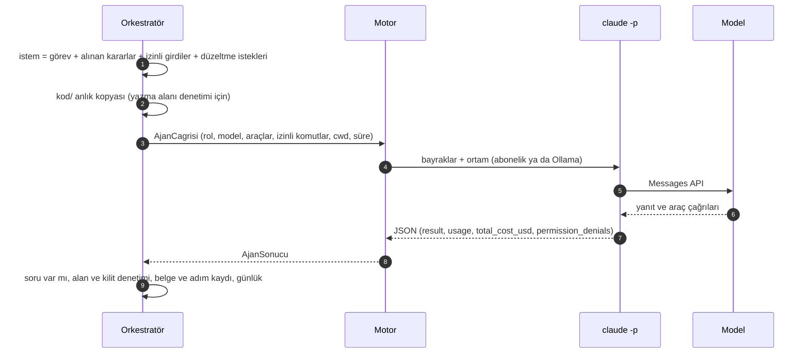

`claude -p`'ye giden başlıca bayraklar: `--output-format json`, `--model`, `--system-prompt` ya da `--append-system-prompt`, `--tools`, `--allowedTools`, `--permission-mode acceptEdits` (yalnızca yazan ajanlarda), `--json-schema` (onaylarda), `--max-budget-usd`, `--no-session-persistence`. Kovan, yüklü `claude` sürümünün desteklemediği bayrakları göndermez.

### Bir fikrin durumları

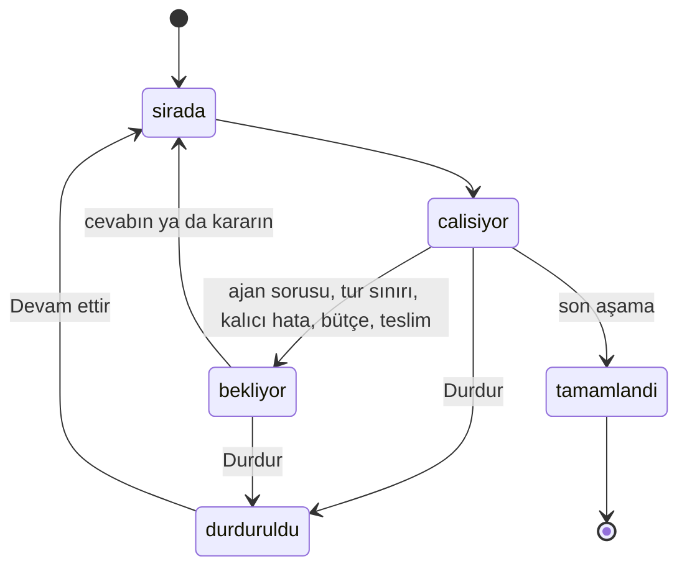

Sunucu kapanırsa yarıda kalan işler bir sonraki açılışta `bekliyor` durumuna alınır ve "Tekrar dene" seçeneğiyle sana sorulur.

### Akışlar

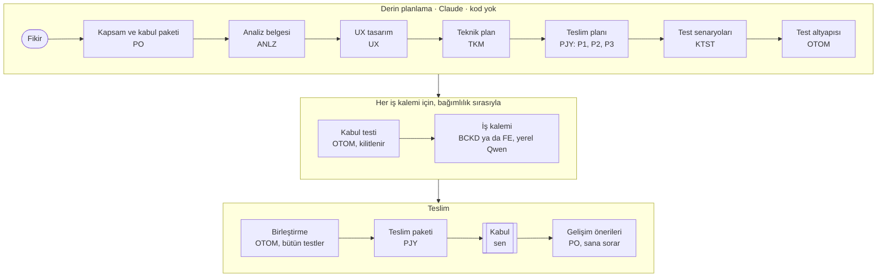

Tam yığın akış yukarıdaki gibi. Standart akışta UX ve FE kalemleri yok. Mini akış kısa yol: Brif → Otomatik testler → BE → Kabul (onay kurulu ve ortak karar yok).

| Akış | Ne için | Aşamalar | Deneme motorunda çağrı (3 kalem) |
|---|---|---|---|
| **Mini** | küçük BE işleri | Brif → Otomatik testler → BE → Kabul | 5 |
| **Standart (BE)** | arayüzsüz işler | planlama (6 aşama) → kalemler → birleştirme → teslim → kabul → gelişim | ~64 |
| **Tam yığın (FE+BE)** | arayüzlü işler | yukarıdaki + UX tasarım, FE kalemleri | ~64 |
| **Replatform** | var olan bir sistemi yeniden yazmak | mevcut sistemi anlama → kapsam → hedef analiz → teknik plan → teslim planı → testler → kalemler → birleştirme → entegrasyon kılavuzu → teslim → kabul → gelişim | ~77 |
| **Mevcut proje üzerinde iş** | var olan projede hata, özellik, entegrasyon | keşif → öneri kartı → baz çizgisi → (küçük: kıran test → düzeltme) ya da (orta, büyük: fark analizi → teslim planı → kalemler → birleştirme) → değişiklik notu → kabul → yama | 11 (küçük iş) |

Yeni fikir ekranında akışı değil, **nereden başladığını** seçersin: *Sıfırdan* (Mini, Standart, Tam yığın arasından seçersin), *Mevcut proje üzerinde iş* ya da *Mevcut sistemi yeniden yaz*. Son ikisinde akış seçimi yoktur.

Derin planlama bilerek pahalı: kod yazılmadan önce kapsam, analiz, plan ve testler onaylanmış olur. Küçük işi tam yığına sokma; her soru ve düzeltme turu birkaç çağrı ekler.

### Sınır modeli: katmanlı savunma

| Katman | Nerede uygulanır | Ne sağlar |
|---|---|---|
| Rol, görev, "yapma" listesi | ajan kartı (prompt) | Ajan kendi işine odaklanır |
| Ne okuyabilir | akıştaki `girdiler` | Ajan yalnızca kendisine verilen belgeleri ve senin kararlarını görür |
| Araçlar | `--tools` | Belge ve onay ajanlarında hiç araç yok |
| Komut izni | `--allowedTools` | Yalnızca kartta izinli komutlar; gerisi reddedilir ve "İzin reddi" olarak görünür |
| **Yazma alanı** | çalıştırma öncesi/sonrası karşılaştırma | Ajan kendi klasörü dışına yazarsa değişiklik geri alınır, "sınır ihlali" kaydedilir |
| **Kilit** | SHA-256 + geri alma | Testler ve tasarım onaydan sonra değiştirilemez |
| Doğrulama | `bash test-be.sh` / `test-fe.sh` | Kod gerçekten çalıştırılır; LLM'in "çalışıyor" demesi yetmez |
| Onay kurulu | paralel inceleyenler, JSON şemalı karar | Hepsi ONAY vermeden aşama geçmez |
| **Soru sınırı** | orkestratör (`en_fazla_soru_turu`) | Ajan seni darlamaz; hak dolunca varsayımla devam etmesi söylenir |
| **Ortak karar** | orkestratör (`ortak_karar`) | Sorular önce kurulda oylanır; oybirliği yoksa, oy okunamazsa ya da biri "sahibine bırak" derse sana gelir |
| **Salt okunur kaynak** | kilit + salt okunur aşama | Eski sistemin kopyasına kimse yazamaz; Mevcut Sistem Analisti hiçbir dosyaya yazamaz, yazarsa geri alınır |
| **Kod atıfları** | atıf denetimi | Mevcut sistem analizindeki her `kaynak/<dosya>:<satır>` gerçek bir dosya ve satıra gitmeli; uydurma atıf onay kuruluna gitmeden geri döner |
| **Büyük Birader** | onay kurulundan sonra, salt okunur | İşin tamamına bakar; veto kanıt ister, senin kararını veto edemez, aşama başına veto sınırı var, hiçbir şeye yazamaz |
| **Onay kapısı** | orkestratör (`katilim`) | Kapı açık aşamada kararları onaylamadan aşama tamamlanmaz; kilit ve mimari karar kayıtları onaydan sonra yazılır |
| **Konuşma** | salt okunur çağrı | Soru sorulan ajan dosya yazamaz, komut çalıştıramaz; cevabı sen karara bağlamadan hiçbir şey değişmez |
| **Öneri kartı** | keşif + senin onayın | Mevcut projede ajanların yazma alanı keşiften gelir ve **sen onaylamadan** yürürlüğe girmez; yollar `proje/` altında olmalı, projenin tamamı verilemez, projede karşılığı olmayan yol geri döner |
| **Baz çizgisi** | ajansız kontrol aşaması | Projenin testleri işe başlamadan koşar; kırmızıysa iş başlamaz (hangi hatanın bu işten geldiği ayırt edilemezdi) |
| **Önce kırmızı** | `beklenen: kirmizi` | Yeni test, kod yazılmadan önce başarısız olmalı; geçiyorsa isteneni yakalamıyordur ve onay kuruluna gitmeden yazara döner |
| **Projeye dokunmama** | kopya + yama | Verdiğin klasöre ve sürüm kontrolüne yazılmaz; sır taşıyabilecek dosyalar (`.env`, anahtar, sertifika) kopyalanmaz |
| **Hepsi yerel** | motor seçimi | Oylar ve onaylar dahil hiçbir çağrı buluta gitmez; yerel motor yoksa iş durur, Claude'a düşülmez |
| **Kurum LLM'inde araçlar** | Kovan'ın ajan döngüsü | Yollar çalışma dizinine hapsedilir (`..`, mutlak yol, sembolik bağ); Bash yalnızca kartın izinli kalıplarına uyan komutları çalıştırır, `$( )` reddedilir; API anahtarı istemde, günlükte ve Bash'in ortamında yok |
| **Plan biçimi** | `kovan-plan` denetimi | Kalem kimlikleri, yazılımcı, bağımlılık ve döngü sistemce denetlenir; bozuk plan onay kuruluna gitmeden düzeltmeye döner |
| Süre, bütçe, tur | orkestratör | Takılan adım durdurulur; sınırda karar sana kalır |
| Önizleme yalıtımı | sandbox CSP | Ajanın yazdığı HTML, Kovan'a senin adına istek atamaz |
| Host ve köken denetimi | sunucu | Başka bir site localhost'taki Kovan'a istek atamaz, DNS rebinding işe yaramaz |

> Sınırlar halüsinasyonu **azaltır**, tek başına **engellemez**. Yakalayan şey doğrulamadır: başka bir modelin incelemesi, gerçekten çalışan test ve senin kararın.

### Veri ve klasörler

```
kovan/
├─ Baslat.command      çift tıkla (macOS)
├─ Ollama-Kur.command  Qwen hibrit için tek tık kurulum (macOS)
├─ kovan.yaml          ayarlar: mod, yerel motor, paralel iş, ajan soruları, ortak karar
├─ ajanlar/            13 ajan kartı (12 ekip üyesi ve Büyük Birader)
├─ akislar/            mini, standart, tam-yigin, proje, replatform
├─ ornekler/           reeskont-eski: replatform için kurgusal eski sistem; proje-ornek: mevcut proje işi için küçük, hatalı bir proje
├─ sunucu/src/         Node.js + TypeScript sunucu ve orkestratör
├─ sunucu/test/        Vitest testleri
├─ arayuz/             Vite + React + TypeScript arayüz (derlenmiş hali arayuz/dist)
└─ calisma/            (git'te yok) fikirlerin çıktıları
   └─ F-001/
      ├─ belgeler/     brif, analiz, planlar, kalem notları, kararlar.md, onaylar.md, birader-defteri.md, gelisim-defteri.md  (_surumler/ eski sürümler)
      ├─ incelemeler/  her ONAY / DÜZELT / SORU kararı
      ├─ kod/          ÜRÜN: backend/  frontend/  testler/  adr/ (kilitli)  kaynak/ (replatform, kilitli)  tasarim/  test-be.sh  test-fe.sh
      │                mevcut proje işinde: proje/ (çalışma kopyası)  kaynak/ (ekler, kilitli)
      ├─ cikti/        mevcut proje işinde: degisiklik.patch, OKU.md, degisiklik-notu.md, dosyalar/ (yamaya girmeyenler)
      ├─ gunluk/       her çağrının tam istemi, komutu ve ham çıktısı
      └─ .kovan/       fikir.json, adimlar.json, kararlar.json, plan.json, adr.json, gelisim.json, kilit kaydı, anlık kopya;
                       onaylar.json, birader.json, sohbet.json;
                       mevcut proje işinde is.json (onaylanan öneri kartı), yama.json, proje-asil/ (dokunulmamış kopya)
   └─ .cop/            silinen fikirler (F-004-20261119...); geri almak için klasörü calisma/ altına geri taşı ve Kovan'ı yeniden başlat
```

**Ürün nerede?** Fikir ekranında başlığın altında klasörün yolu yazar; **Kodu aç** düğmesi `kod/` klasörünü Finder'da (Windows'ta Explorer) açar. Ekranda **Dosyalar** panelinin **Kod** sekmesinde de dosyaları okuyabilirsin. Ürünü kendi deposuna almak için `kod/` altındaki `backend/`, `frontend/`, `testler/` ve `adr/` klasörlerini kopyala; `kaynak/` eski sistemin kopyasıdır, ürüne girmez. Mevcut proje işinde ürün `kod/` değil **yamadır**: `cikti/degisiklik.patch` (bkz. [Mevcut proje üzerinde iş](#mevcut-proje-üzerinde-iş-hata-özellik-entegrasyon)).

**Fikir silmek.** Fikir ekranında **Sil**: fikir listeden kalkar, klasörü `calisma/.cop/` altına taşınır (kalıcı silme yok). Çalışan fikir silinmez; önce **Durdur**. Silinen fikrin numarası yeniden kullanılmaz.

Her ajan çağrısı, test koşumu, soru ve karar `adimlar.json`'da bir kayıttır: aşama, tür, ajan, motor, model, tur, deneme, süre, token, maliyet, sonuç, özet ve ilgili dosya.

### Tasarım kararları

1. **Ajan = markdown kart.** Ekibi büyütmek için kod yazmak gerekmez, kart yazmak yeter.
2. **Sınırın çoğu sistemde.** Prompt ikna eder; araç kısıtı, izin kuralı, yazma alanı denetimi ve kilit zorlar.
3. **Doğrulama LLM'den bağımsız.** Testleri orkestratör çalıştırır; sonuç çıkış kodudur.
4. **Testler koddan önce ve kilitli.** "Bitti"nin tanımı yazılımcıdan önce sabitlenir.
5. **Üreten ≠ onaylayan.** Hibritte kodu Qwen yazar, Claude onaylar. Aynı modelin kendi hatasını görmesi zordur.
6. **Sormak varsaymaktan ucuz, ama sınırlı.** Pahalı belirsizlikte ajan sorar; küçük konuda "VARSAYIM:" yazıp devam eder. Soruyu önce ekip oylar; sana yalnızca anlaşamadıkları ya da senin vermen gereken kararlar gelir. Kararlar defterde birikir ve bağlayıcıdır.
7. **Kod, plandan sonra.** İş, bağımlılık sırasıyla küçük kalemlere bölünür; her kalemin kabul testi koddan önce yazılıp kilitlenir. Küçük ve net kalem, yerel modelin işini kolaylaştırır.
8. **Sonsuz döngü yok.** Tur sınırı ve kalıcı hata sana gider. Hibritte "Claude'a devret" bir kaçış kapısıdır.
9. **Geri dönüşte yeniden doğrulama.** Sonraki aşamalar baştan yazılmaz; testler ve kurul tekrar bakar.
10. **Tek makine.** localhost, JSON dosyaları, dosya sistemi. Kurulumu `Baslat.command` kadar basit.
11. **Sürüm toleransı.** `claude --help` okunur, desteklenmeyen bayrak gönderilmez.
12. **Abonelik yalıtımı.** Claude ajanlarında `ANTHROPIC_BASE_URL`/`ANTHROPIC_API_KEY` gibi yönlendirme değişkenleri temizlenir. Böylece yanlışlıkla API'ye ya da yerel modele gidilmez.

---

## Kararlar: önce ekip, gerekirse sen

Ajan bir karar veremediğinde ve yanlış bir varsayım işi boşa çıkaracaksa durur ve soru sorar. Soru her zaman aynı biçimde gelir:

- kısa bir **başlık** (ör. "Kişisel veri") ve tek başına anlaşılır **net bir soru**,
- **2-4 seçenek**, her birinin altında seçilirse ne olacağını anlatan bir açıklama,
- ajanın **önerdiği seçenek ilk sırada**, "Önerilen" rozetiyle,
- her zaman **kendi cevabını** yazabileceğin ya da seçimine not ekleyebileceğin bir alan,
- birden çok seçenek seçilebilecekse çoklu seçim.

**Ortak karar.** Soru önce sana değil, ekibe gider. Ürün Sahibi, Mimar ve Analist bağımsız oy verir; soruyu soranın önerisi de bir oydur. Hepsi aynı seçeneği seçerse karar ekibindir, sana sorulmaz ve deftere "ekip kararı, oybirliği" diye yazılır. Anlaşamazlarsa soru sana gelir: her seçeneğin yanında ona kimin oy verdiği, altında ekibin gerekçeleri durur.

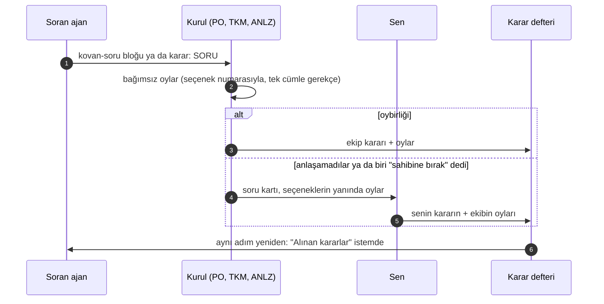

Bazı kararlar ekibin değildir. **Para ve bütçe, hukuki bir riski kabul etmek, geri dönüşü olmayan bir işlem, marka ya da iş stratejisi** gerektiren sorularda ajan `"insan": true` işaretler; bunlar oylanmadan doğrudan sana gelir. Kurul üyelerinden biri "bu karar sahibinin" derse (`insana_birak`), oy okunamazsa ya da aşamanın soru hakkı dolmuşsa da soru sana gelir. Varsayılan güvenli taraftır: emin olunamayan her durumda karar sende.

Ayarlar (`kovan.yaml`): `ortak_karar.kurul` (kimler oylar), `ortak_karar.kural` (`oybirligi` ya da `cogunluk`), `ortak_karar.acik`. Bir akışta kapatmak için akış dosyasına `ortak_karar: false` (Mini'de kapalı).

**İki kaynak:**
- **Üreten ajan**, işe başlamadan ya da iş sırasında sorar. Örnek: Ürün Sahibi brifi yazmadan önce arayüz dilini sorar; ekip oybirliğiyle "Türkçe" der.
- **Onaycı**, inceleme sırasında `"karar": "SORU"` verir. Örnek: Mevzuat, analizi incelerken kişisel veri toplanıp toplanmayacağını sorar; ekip bölünür, soru sana gelir.

**Karar defteri:** Kararlar `belgeler/kararlar.md` ve `.kovan/kararlar.json`'a yazılır: kimin karar verdiği (ekip ya da sen) ve oylar dahil. Sonraki bütün ajanların isteminde "Alınan kararlar" bölümü olarak yer alır; ortak kurallar bunları bağlayıcı sayar. Arayüzde "Kararlar" sekmesinde ve teslim özetinde ayrı ayrı görünür.

**Mevzuat yalnızca gerektiğinde.** Mevzuat ajanı ilk incelemesinde fikirde kişisel veri, ödeme, sektörel düzenleme gibi bir konu yoksa `"kapsam_disi": true` der; sonraki aşamalarda (`atlanabilir: true` olan yerlerde) çağrılmaz, zaman çizelgesinde "Kapsam dışı" notu düşer. Konu varsa normal inceler ve gerektiğinde sorar.

**Sistem kararları** aynı kart düzeniyle gelir:

| Durum | Seçenekler (önerilen ilk) |
|---|---|
| Aşama sonu kapısı | her karar için Onaylıyorum · Değiştir (notla); mimari kararda seçeneklerden biri |
| Büyük Birader veto sınırı | Bir tur daha · Olduğu gibi kabul et · Durdur |
| Büyük Birader değerlendiremedi | Tekrar dene · Bu aşamada Büyük Birader olmadan devam et · Durdur |
| Teslim (insan kapısı) | Kabul ediyorum · Notumla geri gönder (hangi aşamaya) · Durdur |
| Tur sınırı | Bir tur daha (hibritte yerel aşamada önce: Bu aşamayı Claude'a devret) · Olduğu gibi kabul et · Durdur |
| Kalıcı hata | Tekrar dene · Claude'a devret (yerel aşamada) · Bu aşamayı atla · Durdur |
| Bütçe doldu | Bütçeyi artır ve devam et · Durdur |
| Yarıda kalan iş | Tekrar dene · Durdur |


**Analiz aşamalarında sen döngüdesin.** Analizdeki yanlış bir varsayım bütün işi boşa çıkarır; ekibin oybirliğiyle yanlış tarafı seçmesini en sondaki kabulde görmek geç olur. Bu yüzden Replatform'da *Mevcut sistemi anlama*, *Kapsam* ve *Hedef analiz*, Standart ve Tam yığın'da *Kapsam* ve *Analiz* aşamalarında iki ayar açık:

| Ayar (akış dosyasında, aşama başına) | Ne olur |
|---|---|
| `once_soru: true` | **Kontrol noktası.** Ajan belgeyi yazmadan önce işin sonucunu en çok değiştirecek 1-3 açık soruyu ve önemli varsayımlarını sana getirir (önce doküman-kod çelişkileri). Bu sorular oylanmaz. Cevaplarınla aynı aşama yeniden çalışır ve belge yazılır. Ajan soru sormazsa zaman çizelgesine not düşer |
| `is_kurali_sana: true` | Aşamanın geri kalanında ajanlar soruya `konu` yazar. **İş kuralı** soruları (doküman-kod farkı, hesap, yuvarlama, tarih, kapsam, hata davranışı, mevzuat yorumu) ekibe uğramadan sana gelir; **teknik** sorular (teknoloji, yapı, araç) önce ekipte oylanır. Konu yazılmamışsa soru sana gelir |

Bunlar her analiz aşamasına bir soru turu ekler: biraz daha uzun sürer ve biraz daha çok token harcar. Kapatmak için akış dosyasında ilgili satırları sil; Mini akışta kapalı.

**Seni darlamasınlar diye:** sorular önce ekipte çözülür; bir aşamada en fazla `en_fazla_soru_turu` (varsayılan 2) soru turu açılır. Hak dolunca ajanlara "VARSAYIM yaz, devam et" denir. Soruları tamamen kapatmak için `kovan.yaml`'da `ajan_sorulari: false`.

**Haberin olsun diye:** bir fikir seni beklediğinde sekme başlığı "(N) Kovan" olur; üst çubuktaki **Bildirim al** ile sekme arka plandayken masaüstü bildirimi gelir.

---

## Büyük Birader ve onay kapıları

Teslimde tek bir "kabul ediyorum" geç kalır: o noktada kapsam, analiz ve mimari çoktan kilitlenmiştir. Bu yüzden her aşama, onay kurulundan geçtikten sonra iki göze daha uğrar: önce işin tamamını gören Büyük Birader'e, sonra sana.

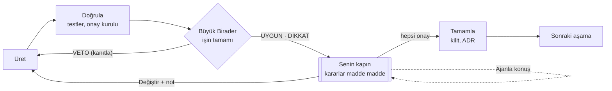

### Büyük Birader
Adını 1984'ten alır ama son söz onda değil, sendedir. Ekipteki herkes yalnızca kendi aşamasının girdilerini görür; Büyük Birader **işin tamamını** görür: fikir, bütün belgeler, karar defteri, onayların, onay kurulunun incelemeleri, test sonuçları ve aşama aşama gidişat (tur sayıları, sınır ihlalleri, izin retleri). Ekranda petek şeridinin tepesindeki gözdür: rengi son hükmünü gösterir, bakışı o anki aşamaya döner, tıklayınca aşama aşama değerlendirmeleri açılır.

Aşamanın kendi içindeki kaliteye onay kurulu bakar; Büyük Birader aşamalar **arasına** bakar: kapsamdan sapma, alınmış bir kararla çelişki, girdide dayanağı olmayan iddia, karşılanamaz hale gelen kabul kriteri, yok sayılan güvenlik ya da mevzuat kararı.

| Hüküm | Ne olur |
|---|---|
| **Uygun** | Aşama senin kapına gelir (kapı yoksa ilerler). |
| **Dikkat** | Akışı durdurmaz. Uyarı tepede ve kapı kartında görünür. Sorun önceki, onaylanmış bir aşamadaysa hangi aşamaya geri göndermeni önerdiğini söyler; geri göndermek senin kararın. |
| **Veto** | Aşama, kanıtlı bulgularla yazarına geri döner. Onay kurulu yeniden bakmaz (onayları korunur); Büyük Birader yeniden bakar. Veto turu aşamanın tur hakkından yemez. |

Veto gücünün sınırları:
- **Kanıt ister.** Her veto bulgusu bir belgeye ya da aşamaya ve oradaki ifadeye dayanmalı. Kanıtsız veto sistemce Dikkat'e düşürülür ve aşama geri çevrilmez.
- **Senin kararını veto edemez.** "Alınan kararlar" bağlayıcıdır; yanlış bulursa Dikkat ile söyler.
- **Üslubu, biçimi, tercih farkını veto edemez;** onay kurulunun baktığı aşama içi ayrıntıyı yeniden tartışmaz.
- **Akışı kilitleyemez.** Bir aşamada en fazla `en_fazla_veto` (varsayılan 2) veto; sonrakinde karar sana gelir (bir tur daha, olduğu gibi kabul et, durdur). Değerlendirme alınamazsa da akış durmaz: tekrar dene ya da o aşamada onsuz devam et.
- **Hiçbir şeye yazamaz.** Araçları yalnızca okuma (`Read`, `Glob`, `Grep`); ajanlara talimat veremez, yalnızca hükmünü yazar.

Değerlendirmeleri `belgeler/birader-defteri.md` dosyasında birikir ve bir sonraki değerlendirmesine girer. Bir çağrısı her aşama turuna eklenir; Tam yığında üç kalemle kabaca 17-20 ek çağrı demektir. Claude'daki ucuz inceleme modeli (`claude_inceleme_modeli`) ona uygulanmaz. **Hepsi yerel** modunda yazarla aynı modelde koşar; "farklı model farklı hatayı yakalar" ilkesi yalnızca Hibrit'te tam işler.

Ayar: `kovan.yaml` → `buyuk_birader: { acik: true, en_fazla_veto: 2 }` (kısaca `buyuk_birader: false`). Bir akışta kapatmak için akış dosyasına `buyuk_birader: false` (Mini'de kapalı). Kartı: `ajanlar/buyuk-birader.md`.

### Onay kapıları
Kapı açık olan bir aşama bitince o aşamada **karara bağlananlar madde madde** önüne gelir. Her ajan belgesinin sonuna bir karar özeti yazar (`kovan-ozet`: ne karara bağlandı, neden, alternatifi neydi; varsayımlar ve kapsam maddeleri ayrı ayrı). Kart şöyle görünür:

- En üstte **Büyük Birader'in değerlendirmesi**.
- Her karar için **Onaylıyorum** ya da **Değiştir**. Not yazdığın madde değişiklik isteği sayılır.
- **Mimari kararlar seçenekleriyle** gelir: Mimar seçenekleri artısı ve eksisiyle hazırlar, birini önerir; **seçimi sen yaparsın**.
- Son madde **Belgenin geneli**: özette olmayan bir şeyi buradan istersin.

Hepsini onaylarsan aşama tamamlanır: kilitler ve mimari karar kayıtları (`adr/`) o anda yazılır, onayın `belgeler/onaylar.md` dosyasına geçer. Bir maddeyi değiştirirsen aynı aşama notlarınla yeniden çalışır; onay kurulu ve Büyük Birader yeniden bakar, kapı yeniden açılır. Senin istediğin tur, aşamanın tur hakkından yemez. Değiştirdiklerin karar defterine "senin kararın" olarak girer ve sonraki bütün ajanlar için bağlayıcıdır; onayladıkların deftere girmez (belgenin kendisinde durur), yoksa defter her isteme eklendiği için büyür.

Kapının hangi aşamalarda açılacağını fikri başlatırken seçersin; fikrin sayfasından sonradan değiştirebilirsin:

| Onay kapıları | Kapı nerede açılır |
|---|---|
| **Planlama aşamalarında** (varsayılan) | Kapsam, analiz, UX tasarım, teknik plan, teslim planı (akış dosyasında `kapi: true` olan aşamalar). Kod aşamaları kendi akar. |
| **Her aşamada** | Test ve kod aşamaları dahil her ajan aşaması. En çok söz, en çok bekleme. |
| **Yalnızca sonda** | Kapı yok; yalnızca ajanların soruları ve Kabul sana gelir. |

Ayrıca teknik planda `once_soru` açıktır: Mimar planı yazmadan **önce** en çok şeyi değiştiren 1-3 mimari seçimi sana getirir; planı senin cevabınla yazar.

Varsayılan: `kovan.yaml` → `katilim: planlama`.

### Ajanla konuşmak
Fikir çalışmıyorken (kapıda, durdurulmuşken ya da bittiğinde) fikrin sayfasındaki **Ajanlarla konuş** bölümünden, belgesi yazılmış herhangi bir aşamanın ajanına ya da Büyük Birader'e soru sorarsın: "Bunu neden böyle seçtin?", "Öbür yol neye mal olurdu?", "Bu iş nereye gidiyor?".

- Ajan belgesini (kod aşamasında ve Büyük Birader'de dosyaları da) okuyarak cevaplar. **Hiçbir şeyi değiştiremez**: yazma ve komut aracı yoktur.
- Cevap bir karar değildir. Vardığınız sonucu **Karara bağla** ile bir cümle olarak yazarsan deftere "senin kararın" olarak girer ve sonraki bütün ajanlar görür. Aşamanın o karara göre yeniden yazılmasını istiyorsan kapıda **Değiştir** dersin.
- Her soru bir model çağrısıdır: bütçeye ve zaman çizelgesine girer, yerel modelde dakikalar sürebilir. Aynı anda fikir başına tek soru.

---

## Derin planlama ve iş kalemleri

Kod, plan onaylanmadan başlamaz. Planlama aşamaları sırayla:

| Aşama | Kim | Ne üretir | Kim onaylar |
|---|---|---|---|
| Kapsam ve kabul paketi | PO | problem, kapsam içi/dışı, ölçülebilir kabul kriterleri (K1...) | – |
| Analiz belgesi | ANLZ | kurallar, uç durumlar, hata davranışı | PO (kapsam), TKM (uygulanabilirlik), KTST (uç durum ve kalite), UYUM (konu varsa) |
| UX tasarım (tam yığın) | UX | akışlar, tıklanabilir prototip, arayüz sözleşmesi | PO, ANLZ, UYUM (konu varsa) |
| Teknik plan | TKM | dosyalar, imzalar, kararlar, uygulama sırası | ANLZ, SCRT, UYUM (konu varsa) |
| Teslim planı | PJY | sıralı iş kalemleri ve bağımlılıklar, `kovan-plan` bloğu | sistem (plan biçimi), PO, TKM |
| Test senaryoları | KTST | her kaleme bağlı TS-ID'ler | PO, ANLZ |
| Test altyapısı | OTOM | test projesi ve `test-be.sh`/`test-fe.sh` (kilitlenir) | test koşumu, KTST |

Teslim planı onaylanınca **İş kalemleri** aşaması açılır: plandaki her kalem için, bağımlılık sırasıyla iki aşama oluşur.

| Kalem aşaması | Kim | Doğrulama |
|---|---|---|
| **P1 Kabul testi** | OTOM, yalnızca `testler/<taraf>/p1/` | Senaryo incelemesi (ANLZ), Kapsama (KTST); sonra kilitlenir |
| **P1 İş kalemi** | kalemin yazılımcısı (BE ya da FE, hibritte yerel Qwen) | Testler (bütün kalemlerin testleri birlikte: regresyon), Uygunluk (ANLZ), Kod incelemesi (TKM), Test incelemesi (KTST: testlere özel hile var mı), Güvenlik (SCRT), FE kaleminde UX |

Ardından **Birleştirme** (uçtan uca senaryolar ve bütün testler), **Teslim paketi** (PJY), **Kabul** (sen) ve **Gelişim önerileri** gelir. Arayüzde her kalemin hücreleri bir çerçevede durur; altında "İş kalemleri" tablosu (kalem, kapsam, yazılımcı, bağımlılık, kabul kriterleri, durum) ve "Sırada" satırı görünür.

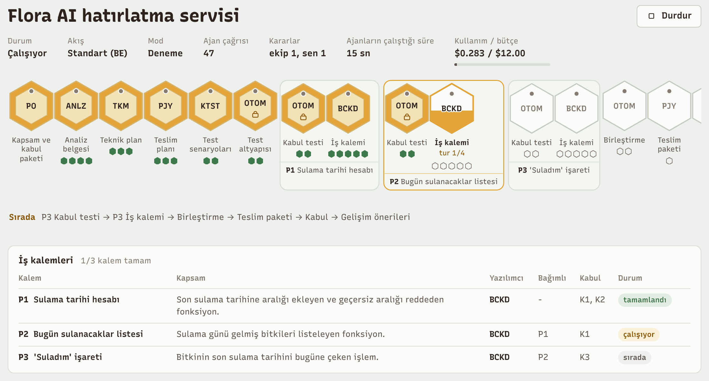

`kovan-plan` bloğu (Proje Yöneticisi'nin belgesinin sonunda):

```yaml
- id: P1
  baslik: Sulama tarihi hesabı
  gelistirici: be-yazilimci
  bagimli: []
  kabul: [K1, K2]
  kapsam: backend/src/sulama.ts içindeki sonrakiSulama(sonSulama, aralikGun)
- id: P2
  baslik: Bugün sulanacaklar listesi
  gelistirici: be-yazilimci
  bagimli: [P1]
  kabul: [K3]
  kapsam: backend/src/liste.ts içindeki bugunSulanacaklar(bitkiler, bugun)
```

Teslimde bir kaleme geri gönderirsen yalnızca o kalem yeniden çalışır, sonrakiler yeniden doğrulanır. Teslim planına geri gönderirsen kalemler yeni plandan açılır; değişmeyen kalemler yeniden yazılmaz.

### Mimari karar kayıtları (ADR)

Standart, tam yığın ve replatform akışlarında Mimar, teknik planda önemli her kararı bir ADR olarak yazar: bağlam, **en az iki seçenek** (her birinin artısı ve eksisi), karar, rakamlı gerekçe, sonuçlar ve ilgili kurallar (E3, P2).

```
Teknik plan ── ```kovan-adr bloğu
   │
   ├─ Sistem denetimi "ADR biçimi" (makine; onay kurulundan önce)
   │    iki seçenek yok, karar bir seçeneğin adı değil, zorunlu alan eksik → mimara geri döner
   │
   ├─ Onay kurulu (Analist, MSA, Güvenlik...)
   │
   └─ Onaydan sonra: kod/adr/ADR-001-....md + adr/README.md (dizin) → KİLİTLİ
         yazılımcılar istemlerinde "MİMARİ KARARLAR adr/ altında" görür, değiştiremez
         kod incelemesinde Mimar koda ADR'lere göre bakar; aykırı kod DÜZELT'tir
```

| Akış | Kural |
|---|---|
| Replatform | En az 2 ADR; biri `calisma_bicimi` alanında olmak zorunda: eski sistemin her giriş noktası **batch job mı, REST endpoint mi, ikisi mi** |
| Standart, Tam yığın | En az 1 ADR |
| Mini | Teknik plan yok, ADR yok |

ADR'ler fikir ekranında **ADR** sekmesinde, seçilen seçenek işaretli olarak görünür. Teknik plan yeniden çalışırsa (geri gönderme, yeni sürüm) kilit kalkar ve `adr/` yeniden yazılır. Alanlar: `calisma_bicimi`, `veri`, `performans`, `hata`, `guvenlik`, `entegrasyon`, `test`, `diger`. Akış dosyasında: `- adr: { en_az: 2, zorunlu: [calisma_bicimi] }`.

---

## Gelişim önerileri ve yeni sürüm

Kabulünden sonra Ürün Sahibi ürünü kullanıcı gözüyle değerlendirir ve 2-5 gelişim önerisi getirir (ne değişir, kullanıcı ne kazanır, efor, öncelik). Bunları ekip oylamaz; ürünün yönü senin kararın. Her öneri sana ayrı bir kart olarak gelir:

- **Evet, sonraki sürüme al**
- **Değiştirerek al**: notuna yazdığın biçimde alınır
- **Şimdilik hayır**: defterde kalır; PO yeni bir gerekçe olmadan yeniden getirmez
- **Hayır, bir daha önerme**

Kararların **gelişim defterine** (`belgeler/gelisim-defteri.md`) yazılır. Kabul ettiklerin varsa fikrin sayfasında yeni sürümün metni hazır gelir; düzenleyip **2. sürümü başlat** dersin. Yeni sürüm önceki sürümün kodunu, kararlarını ve gelişim defterini devralır, aynı derin akıştan geçer; kalemleri eski testlerle çakışmasın diye `v2-p1` gibi adlanır, eski testler regresyon olarak koşmaya devam eder. Kartları o an değerlendirmek istemezsen "Şimdi değerlendirmeyeceğim" ile geçebilirsin.

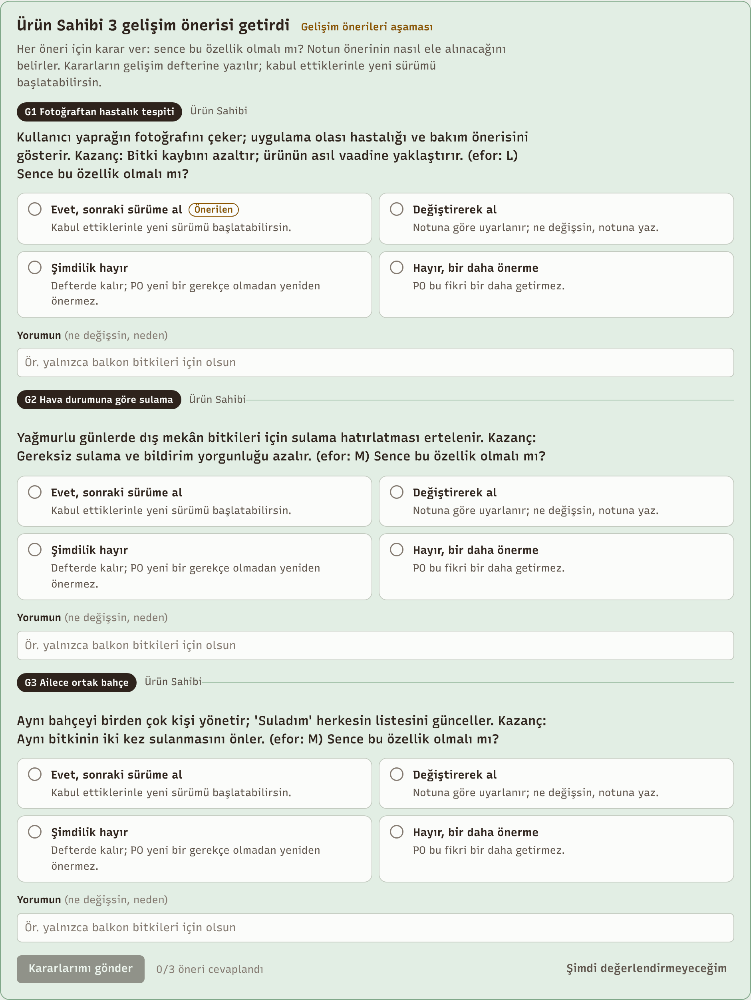

---

## Replatform: mevcut sistemi yeniden yazmak

Var olan bir sistemi (PL/SQL, COBOL, Java, C...) analiz dokümanıyla birlikte verirsin; Kovan onu temiz bir mimariyle ve testli olarak yeniden yazar. Çıktı, kendi sistemine entegre edeceğin koddur: hesaplama saf domain katmanında, dış dünya (veritabanı, muhasebe, parametreler, zamanlayıcı) port olarak durur, adaptörleri sen yazarsın. Yanında entegrasyon kılavuzu ve paralel koşum planı gelir.

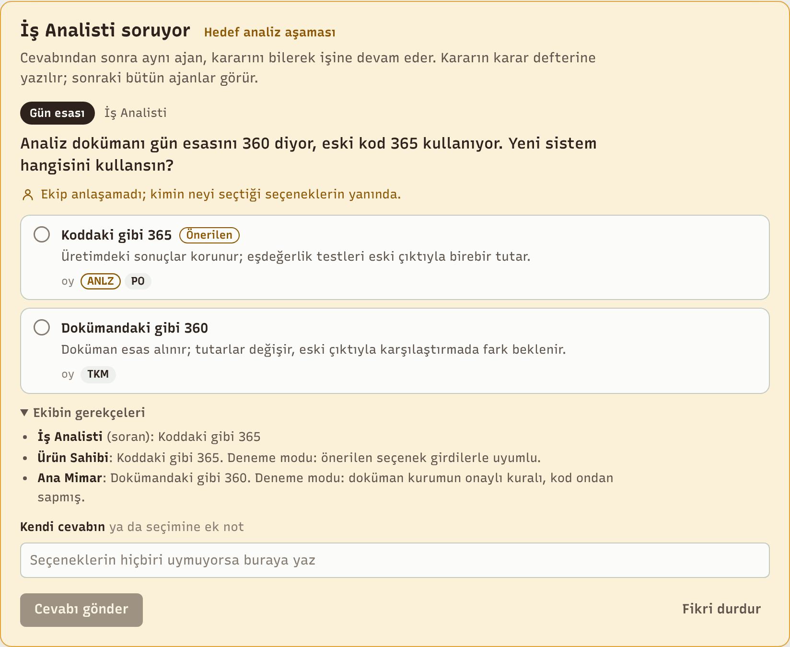

### Kaynakları vermek
Yeni fikirde **Replatform** akışını seç; **Mevcut sistem** alanında **Klasör seç** ya da **Dosya seç** ile Finder'dan seç (birden çok seçilebilir; Linux'ta `zenity` gerekir) ya da yolları satır satır yaz. Klasör, `.zip` ve tek tek dosyalar kabul edilir. Kovan:
- kopyasını fikrin `kod/kaynak/` klasörüne alır, aslına dokunmaz; kopyayı **kilitler** (SHA-256). Ajanlar yalnızca okur; değiştiren olursa sistem geri alır ve sınır ihlali yazar;
- `.git`, `node_modules`, `target`, `build` gibi klasörleri ve ikili dosyaları (`.jar`, `.class`, `.dmp`...) almaz;
- Word belgelerini (`.docx`) tablolarıyla HTML'e çevirir; her paragraf ve tablo satırı ayrı satırdadır, belgeye de satır atfı verilebilir. Eski `.doc` ve `.xls` okunamaz, envantere not düşer;
- Windows-1254 (Türkçe) ve UTF-16 dosyaları UTF-8'e çevirir; satırlar değişmez, atıflar geçerli kalır;
- dökümünü **Kaynak envanteri** belgesine yazar. Sınır: 5.000 dosya, toplam 200 MB, dosya başına 20 MB.

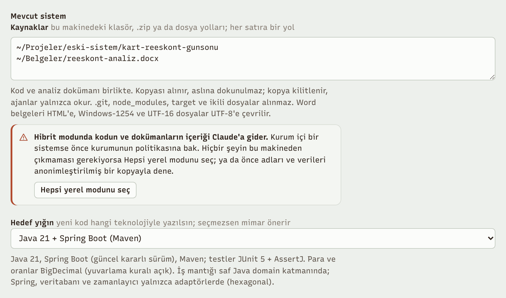

### Akış
| Aşama | Kim | Ne üretir | Kim onaylar |
|---|---|---|---|
| Mevcut sistemi anlama | MSA, salt okunur | giriş noktaları, akış, veri modeli, iş kuralları (E1...), doküman ile kod farkları (FARK), şüpheli davranışlar (ŞÜPHE); her kural `kaynak/<dosya>:<satır>` atfıyla | sistem (atıflar), ANLZ, TKM, KTST |
| Kapsam ve kabul paketi | PO | neler taşınıyor, neler dışarıda; kabul kriterleri, biri mutlaka eşdeğerlik | – |
| Hedef analiz | ANLZ | her eski kural için AYNEN KORU, DEĞİŞTİR ya da BIRAK; yeni kurallar (K1...) eski kurallarla eşli | PO, **MSA (eşdeğerlik)**, TKM, KTST, UYUM (konu varsa) |
| Teknik plan | TKM | domain, uygulama katmanı, portlar; eski tabloların portlara eşlenmesi | ANLZ, MSA, SCRT, UYUM |
| Teslim planı | PJY | önce saf hesap, sonra akış ve portlar | sistem (plan biçimi), PO, TKM |
| Test senaryoları, test altyapısı | KTST, OTOM | eski kurala bağlı senaryolar, altın testler; hedef yığına göre test projesi | ANLZ, MSA, KTST |
| Her kalem | OTOM, sonra BCKD | kilitli kabul testi, sonra kod | ANLZ, MSA, TKM, KTST, SCRT |
| Birleştirme | OTOM | eski sistemin örnek girdisiyle tam bir gün sonu, çıktı eskisiyle karşılaştırılır | TKM |
| Entegrasyon kılavuzu | TKM | modüller, yazacağın adaptörler, yapılandırma, paralel koşum, geçiş ve geri dönüş | ANLZ, MSA |
| Teslim, kabul, gelişim | PJY, sen, PO | teslim paketi (eski kuralların durumu dahil), senin onayın, gelişim önerileri | PO |

### Neyi farklı yapıyor
- **Uydurma atıf geri döner.** Mevcut sistem analizindeki her atfı sistem denetler: dosya var mı, o satırlar var mı. Atıfsız ya da uydurma atıflı analiz onay kuruluna gitmeden düzeltmeye döner. Belgelerdeki atıflar tıklanır: eski sistemin o satırları **Mevcut sistem** sekmesinde vurgulanarak açılır, iddiayı kodla yan yana doğrularsın.
- **Farklar karara bağlanır.** Doküman gün esasını 360, kod 365 diyorsa bu bir FARK'tır. Hedef analizde hangisinin geçerli olduğunu ekip oylar; anlaşamazsa soru oylarla sana gelir. Üretimdeki davranışı değiştiren her karar karar defterinde kalır.
- **Eşdeğerlik ayrı bir onay.** MSA, hedef analizden koda kadar her aşamada "korunan kural eskisiyle aynı mı davranıyor?" diye bakar: yuvarlama, gün sayımı, sıralama, boş ve negatif durumlar.
- **Batch mı, endpoint mi kararı ADR'dir.** Hedef yığını sen seçersin (Batch ya da REST); seçmediysen ya da eski sistemde ikisi birden varsa, eski sistemin her giriş noktası (zamanlanmış iş, ekrandan ya da başka sistemden çağrı) için Mimar `calisma_bicimi` ADR'si yazar; batch step'i de endpoint de aynı saf domain servisini çağırır, kural iki yerde yazılmaz.
- **Altın test.** `kaynak/` altında eski sistemin örnek girdisi ve çıktısı varsa (ör. `girdi.csv`, `beklenen.csv`), birleştirme yeni kodu onunla koşar ve sonucu satır satır karşılaştırır. Anonimleştirilmiş birkaç günlük örnek koyman en güçlü güvencedir.

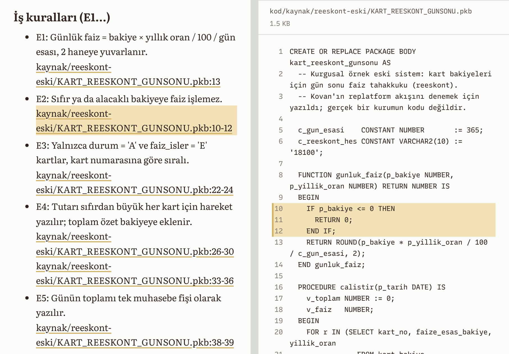

### Hedef yığın
Yeni fikirde seçersen karar defterine yazılır ve bütün ajanlar ona uyar. Seçmezsen mimar önerir.

| Seçenek | Ne zaman |
|---|---|
| Java 21 + Spring Boot (Maven) | yaygın LTS; para ve oran BigDecimal, iş mantığı saf domain'de (hexagonal) |
| Java 25 + Spring Boot (Maven) | yeni LTS'e geçtiysen |
| Java 21 + Spring Boot + Temporal | iş uzun, çok adımlı ve kesintide kaldığı yerden sürmesi gerekiyorsa |
| Java 17 + Spring Batch (Oracle) | milyonlarca kayıtlı gün sonu işi; chunk, partitioning ve yeniden başlatma kararlarını mimar rakamla verir |
| Java 17 + Spring Boot REST (Oracle) | çevrim içi servis: DTO, doğrulama, hata biçimi, idempotency, MockMvc testleri |
| Node.js + TypeScript | Kovan'ın varsayılanı |
| Başka bir yığın | serbest metin, ör. "Java 17 + Spring Boot 3, Gradle" |

Java'da ajanlar Maven ya da Gradle ile derler ve test eder; ilk koşumda bağımlılıklar iner, internet ya da kurumun Maven deposu gerekir.

**Temporal ne zaman gerekir?** Temporal, uzun süren ve adım adım ilerleyen işlerin (gün sonu gibi) kesintide kaldığı yerden sürmesini, yeniden denemeyi ve zaman aşımını altyapıya bırakır. Hesaplamanın kendisini değil, akışın dayanıklılığını çözer. Bu yüzden bir hedef yığın seçeneği olarak duruyor: hesap yine saf Java'da kalır, Temporal yalnızca akışı yönetir. Kurumunda Temporal kümesi yoksa düz Spring Boot ve idempotent adımlarla başlamak daha az iş çıkarır.

### Gizlilik: hangi modda ne makineden çıkar
| Mod | Kaynak kod ve belgeler | Not |
|---|---|---|
| Deneme | hiçbir yere gitmez | gerçek ajan çalışmaz; akışı görmek için |
| **Hepsi yerel** | bu makinede kalır | bütün ajanlar (analiz, onay, oy dahil) yerel modelde; yerel motor yoksa iş durur, buluta düşülmez |
| Hibrit | analiz ve onay ajanları üzerinden Claude'a gider | kodu yerel model yazar |
| Hepsi Claude | Claude'a gider | |

Kurum içi bir sistemse önce kurumunun politikasına bak. Buluta gitmemesi gerekiyorsa Hepsi yerel'i kullan (kurumun kendi LLM'i varsa bkz. [Kurum içi LLM ile çalıştırmak](#kurum-içi-llm-ile-çalıştırmak)) ya da adları ve verileri anonimleştirilmiş bir kopyayla çalış. Hepsi yerel daha yavaştır ve yerel model analizde Claude kadar güçlü değildir; daha çok düzeltme turu ve daha çok soru bekle.

### Örnekle dene
`ornekler/reeskont-eski/` kurgusal bir eski sistemdir: kart reeskont gün sonu PL/SQL paketi, Word analiz dokümanı ve örnek veri. Bilerek iki iz taşır: doküman gün esasını 360 diyor, kod 365 kullanıyor; aynı tarih iki kez çalışırsa çift kayıt oluşur. **Yeni fikir → Örnekle doldur: Kart reeskont gün sonu → Mod: Deneme** ile dene. Mevcut Sistem Analisti farkı satır atfıyla bulur, analist "Gün esası" sorusunu sorar, ekip bölünür ve soru sana gelir; sonunda yeni kod eski sistemin örnek çıktısıyla karşılaştırılır. Deneme motoru gerçek Java yazmaz, seçtiğin yığından bağımsız küçük bir JavaScript örneği üretir.

**Kendi sistemin için:**
- Tek bir işle başla: bir gün sonu paketi, çağırdığı yardımcılar ve onun analiz dokümanı. Bütün şemayı verme.
- Tablo tanımlarını (DDL) ve parametre tablolarından örnekleri ekle; veri modeli oradan çıkar.
- Eski sistemin bir günlük girdi ve çıktısını, anonimleştirerek, CSV olarak koy: altın test onu kullanır.
- `.doc` belgeyi `.docx` olarak kaydet.

---

## Mevcut proje üzerinde iş: hata, özellik, entegrasyon

Bir ürün teslim edilince iş bitmez: canlıdan hata gelir, yeni özellik istenir, başka bir ekibin sistemine bağlanmak gerekir. Bu başlangıçta Kovan'a sıfırdan ürün yazdırmazsın; **var olan projenin üzerinde bir iş** yaptırırsın. Proje Kovan'ın ürettiği bir şey olmak zorunda değil: bu makinede klasörü olan her proje olur.

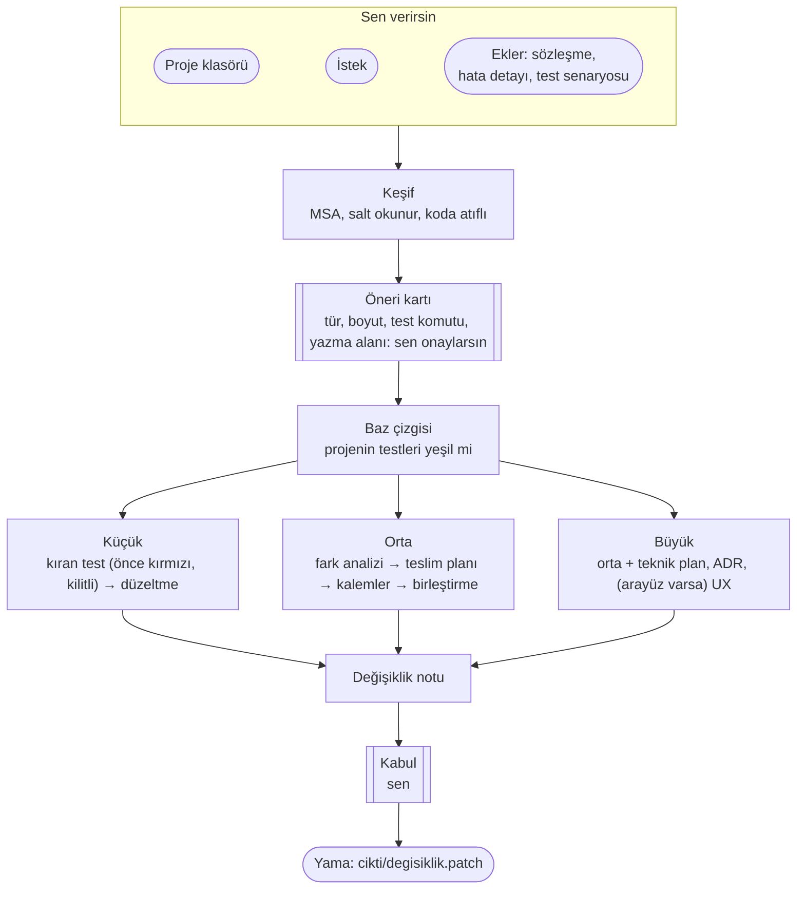

### Ne verirsin
Yeni fikirde **Mevcut proje üzerinde iş**'i seç:
- **Proje klasörü**: projenin bu makinedeki kökü (`pom.xml`, `build.gradle` ya da `package.json`'ın olduğu yer). **Klasör seç** ile de verebilirsin.
- **İstek**: ne yapılsın. Hatada: ne bekleniyordu, ne oldu, nasıl yeniden üretilir. Entegrasyonda: hangi sistemle, hangi işlem için.
- **Ekler** (isteğe bağlı): entegrasyon sözleşmesi (OpenAPI, WSDL, tablo ya da dosya biçimi, örnek istek ve cevap), hata detayı ve log, test senaryoları, analiz notu. Ekler `kod/kaynak/` altına alınır ve kilitlenir; ajanlar okur, atıf verir, değiştiremez.

Akış, tür ya da boyut seçmezsin; onu keşif önerir.

Kovan projenin **birebir kopyası** üzerinde çalışır (kodlama çevirisi yapılmaz); verdiğin klasöre ve sürüm kontrolüne dokunmaz. `.git`, `node_modules`, `target`, `build` gibi klasörler ve sır taşıyabilecek dosyalar (`.env`, `.pem`, `.key`, `.jks`...) kopyalanmaz. Sınır: 5.000 dosya, toplam 200 MB (derleme çıktıları ve bağımlılıklar sayılmaz).

### Öneri kartı
Keşif (Mevcut Sistem Analisti, salt okunur) isteği ve ekleri okur, projede işin geçtiği yeri bulur ve bunu `proje/<dosya>:<satır>` atıflarıyla yazar; sistem her atfı denetler. Belgenin sonunda iş önerisi vardır. Onay kurulundan geçince öneri sana **tek bir kart** olarak gelir:

| Soru | Ne belirler |
|---|---|
| **İş türü**: hata düzeltme, yeni özellik, entegrasyon | Ajanlara giden yönergeyi. Hatada kök neden ve en küçük değişiklik; entegrasyonda sözleşmeden sahte karşı taraf, gerçek ağa çıkmama, bağlantı bilgisinin yalnızca yapılandırmadan okunması |
| **Boyut**: küçük, orta, büyük | Koşacak aşamaları (yukarıdaki üç yol). Küçük iş tek tarafta (BE ya da FE) olur |
| **Test komutu** | Projenin testlerini koşan komutu. Kovan projenin yapısından önerir (`./mvnw -q test`, `mvn -q test`, `./gradlew test`, `gradle test`, `npm test`); kendi komutunu yazabilirsin. Proje kökünde koşar |
| **Yazma alanı** | Ajanların yazabileceği klasör ve dosyaları (`proje/` altında) ve yeni testlerin yerini. Uygun değilse onaylama, ne değişsin yaz: keşif notunla yeniden çalışır |

Kartı onaylamadan kod yazılmaz. Yazma alanının dışındaki her değişiklik sistemce geri alınır ve sınır ihlali olarak kaydedilir.

### Verdiğin her şey bir güvenceye dönüşür
- **Baz çizgisi.** İş başlamadan projenin testleri koşar. Kırmızıysa iş başlamaz; komutu daraltır (ör. yalnızca ilgili modül) ya da durdurursun.
- **Önce kırmızı.** Yeni test (küçük işte *kıran test*, kalemlerde *kabul testi*) kod yazılmadan önce yazılır ve sistem onu koşar: **başarısız olmalı**. Geçiyorsa hatayı ya da isteği yakalamıyordur; onay kuruluna gitmeden yazara döner. Onay kurulu, testin doğru sebeple kırmızı olup olmadığına test çıktısıyla bakar. Sonra test kilitlenir. Kod yazıldıktan sonra teste geri dönersen (ör. kabulden "notumla geri gönder") kırmızı beklenmez; düzeltilen test, kod aşaması yeniden doğrulanırken yeşil olarak koşar.
- **Sonra yeşil.** Yazılımcı yalnızca yazma alanına yazar; kilitli yeni testler ve projenin mevcut testleri birlikte yeşil olmalıdır. Mevcut Sistem Analisti her kod aşamasında "korunması gereken bir davranış bozuldu mu" diye bakar.
- **Test senaryoların.** Eklerde verdiğin her senaryo bir teste çevrilir; hatada, hatayı yeniden üreten girdi aynen kullanılır.

### Çıktı: yama
Kabul aşamasında ve iş bitince `cikti/` klasörü hazırdır (fikir ekranında **Yamayı aç**, Dosyalar panelinde **Yama** sekmesi):

| Dosya | Ne |
|---|---|
| `degisiklik.patch` | Birleşik diff. Projenin kökünde `git apply degisiklik.patch`; git yoksa `patch -p1 < degisiklik.patch` |
| `OKU.md` | Nasıl uygulanır, hangi dosyalar değişti |
| `degisiklik-notu.md` | Ne istendi, ne değişti ve neden, nasıl test edildi, projeye alınırken yapılacaklar, geri alma, riskler |
| `dosyalar/` | Yamaya girmeyenler: ikili ve UTF-8 olmayan dosyaların yeni halleri (elle kopyalanır) |

Sonraki istek için yamayı projene uygula ve aynı klasörle yeni bir iş başlat. Bu başlangıçta "yeni sürüm" yoktur; her iş kendi yamasıyla biter.

### Bilinen sınırlar
- Test komutu senin makinende çalışabilmelidir: derleme aracı ve bağımlılıklar hazır olmalı. `node_modules` kopyalanmaz; gerekiyorsa komutu kurulumla başlat (`npm ci && npm test`).
- Kovan karşı ekibin sistemine bağlanmaz: entegrasyonda testler sözleşmeden üretilmiş sahte karşı tarafla koşar. Gerçek bağlantıyı sen denersin; değişiklik notu bunu "projeye alınırken yapılacaklar"da hatırlatır.
- Eklere parola ya da anahtar koyma; bağlantı bilgisi gerekiyorsa yalnızca ortam değişkeninin adını yaz. Hibrit ve Hepsi Claude modlarında proje ve ekler Claude'a gider (bkz. [Gizlilik](#gizlilik-hangi-modda-ne-makineden-çıkar)).
- UTF-8 olmayan dosyaları (ör. Windows-1254) ajan değiştirirse kodlama bozulabilir; bu dosyalar yamaya girmez, `dosyalar/` altında ayrıca teslim edilir ve notta listelenir. Uygulamadan önce gözle kontrol et.
- Sınır denetimi her ajan çağrısından önce çalışma kopyasının kopyasını alır; büyük projede bu yavaşlatır. İşin geçtiği modülün klasörünü vermek en hızlısıdır.
- Deneme modu yalnızca Kovan'la gelen `ornekler/proje-ornek` ile gerçek bir değişiklik yapar.

### Örnekle dene
`ornekler/proje-ornek` uydurma, küçük bir taksit hesabı projesidir ve bilerek bırakılmış bir hatası vardır (kalan kuruş kaybolur). Yeni fikirde **Taksit planında kalan kuruş** örneğini seç; Deneme modunda token harcamadan kartı, kıran testi ve yamayı görürsün.

---

## Hızlı başlangıç

1. Klasörü bir yere aç, ör. `~/Projeler/kovan`.
2. `Baslat.command`'a çift tıkla. İlk seferde npm paketlerini kurar ve arayüzü derler (~1 dk); sonra tarayıcıda `http://127.0.0.1:8765` açılır.
   - macOS "doğrulanamadı" derse: **Sistem Ayarları → Gizlilik ve Güvenlik → Yine de Aç**. Ya da Terminal'de: `cd ~/Projeler/kovan && bash Baslat.command`
3. **Yeni fikir** → "Örnekle doldur: Flora AI bakım paneli" → Akış **Tam yığın** → Mod **Deneme** → **Fikri başlat**. Token harcamadan bütün ekibi, soruları ve kararları görürsün.
   Küçük bir iş denemek için "Flora AI analiz kredisi" (Mini akış), replatformu denemek için "Kart reeskont gün sonu" (Replatform akışı).
4. Gerçek iş için mod: **Hibrit** (Ollama kuruluysa), **Hepsi Claude** ya da kod makineden çıkmamalıysa **Hepsi yerel**.

**Gereksinimler:** macOS, **Node.js 20.19+ ya da 22.12+** (LTS önerilir), Claude Code (kurulu ve giriş yapılmış: Terminal'de bir kez `claude`). Hibrit için ayrıca Ollama 0.14+.

Terminal'den: `npm install`, `npm run build`, `npm start` (deneme modu varsayılan olsun: `npm run deneme`).

---

## Hibrit için yerel Qwen kurulumu

**Tek tık:** `Ollama-Kur.command`'a çift tıkla. Betik:

1. macOS sürümünü (14+), işlemciyi ve belleği kontrol eder,
2. Ollama yoksa resmî uygulamayı indirip Uygulamalar'a kurar,
3. bağlam uzunluğunu **64k** yapar (`launchctl setenv OLLAMA_CONTEXT_LENGTH`, yeniden başlatmalardan sonra da geçerli) ve Ollama'yı yeniden başlatır,
4. belleğine uygun modeli indirir ve `kovan.yaml`'daki model satırını günceller,
5. Kovan'ın kullandığı yolu (Anthropic uyumlu `/v1/messages`) gerçek bir istekle dener ve yüklü modelin bağlamını gösterir.

Tekrar çalıştırmak güvenlidir; kurulu olanı yeniden kurmaz. Model seçimini ezmek için Terminal'de: `KOVAN_MODEL=qwen3-coder:30b ./Ollama-Kur.command`.

**Elle kurulum:**
1. [Ollama](https://ollama.com) uygulamasını kur. **0.14 veya üstü** olmalı; Claude Code ile konuşabilmesi bu sürümden geliyor.
2. Ollama **Settings → Context length** değerini **64k** yap. Bu en kritik ayar: bağlam küçük kalırsa ajan saçmalar. Ortam değişkeniyle: `launchctl setenv OLLAMA_CONTEXT_LENGTH 65536`, sonra Ollama'yı yeniden başlat. Terminal'den çalıştırıyorsan: `OLLAMA_CONTEXT_LENGTH=65536 ollama serve`
3. Modeli indir: `ollama pull qwen3-coder:30b`
4. Kovan'ı yeniden başlat. Üst çubukta **Yerel: hazır** görmelisin.

| Mac belleği | Model (`kovan.yaml` → `motorlar.qwen-yerel.model`) |
|---|---|
| 32 GB ve üstü | `qwen3-coder:30b` (MoE, hızlı; varsayılan) |
| 16-24 GB | `qwen3.5:9b` (küçük; basit kalemlerde iş görür, zor kalemde "Claude'a devret") |
| 16 GB altı | Yerel ajan kodlaması zayıf kalır. **Hepsi Claude** modunu öneririm. |

**Kovan'ın kendi ajan döngüsüyle (OpenAI uyumlu yol).** Ollama'yı `claude` CLI'ı yerine, bankadaki kurum LLM'iyle aynı yoldan da bağlayabilirsin. Bu Claude Code gerektirmez ve kurum ortamının provasıdır:

```yaml
yerel_motor: qwen-yerel
motorlar:
  qwen-yerel: { tur: openai, adres: http://127.0.0.1:11434/v1, model: qwen3:8b, baglam_token: 32768 }
```

Yerel adresteki (`127.0.0.1`, `localhost`) bir motora aynı anda **tek** ajan çağrısı gider, diğerleri sırada bekler ve süreleri sıraları gelince başlar (Ollama tek istek işler). Kurum sunucusunda varsayılan 4; motor ayarında `es_zamanli` ile değişir. 8B bir model M1'de bir belgeyi 10-20 dakikada yazar; dış ayarda `ajanlar: { "*": { sure_dk: 45 } }` ile süre sınırını büyüt. Ollama'yı bağlamı büyüterek başlat: `OLLAMA_CONTEXT_LENGTH=32768 OLLAMA_FLASH_ATTENTION=1 OLLAMA_KV_CACHE_TYPE=q8_0 ollama serve`. 16 GB'lık bir Mac'te 8-9B model ve 32k bağlam sığar; büyük replatform belgeleri bu bağlamı aşabilir, küçük işlerle başla.

Ollama değişkenlerini (`ANTHROPIC_BASE_URL` vb.) `~/.zshrc`'ye ya da `~/.claude/settings.json`'a yazma. Kovan bunları yalnızca yerel ajanların çağrısına koyar, Claude ajanları için temizler. `settings.json`'daki değerler ise Kovan'ın ayarını ezer.

---

## Kurum içi LLM ile çalıştırmak

Kurumunun kendi LLM servisi (ör. vLLM ya da bir ağ geçidi arkasında Qwen) ve bir API anahtarı varsa bütün ajanları ona bağlayabilirsin. Hiçbir çağrı Claude'a gitmez ve Claude Code gerekmez: `tur: openai` motorunda ajanlar **Kovan'ın kendi ajan döngüsüyle** çalışır.

**Ollama gerekmez.** Ollama yalnızca Hibrit modda, Kovan'ı kendi makinende yerel bir Qwen'le denemek içindir. OpenAI uyumlu `/v1/chat/completions` sunan herhangi bir servis (kurumun LLM'i, iç ağdaki bir vLLM, bir ağ geçidi) adresi ve anahtarıyla doğrudan bağlanır. Kovan'ın çalıştığı makinede yalnızca Node.js ve npm bağımlılıkları gerekir; Docker, Ollama ve Claude Code gerekmez.

```
Tarayıcı ──► Kovan (127.0.0.1:8765) ──► Kovan ajanı (alt süreç) ──HTTPS + anahtar──► https://llm.kurum.local/v1
                    │                          │
                    └── calisma/F-xxx/         └── araçlar: Read, Write, Edit, Glob, Grep, Bash (izinli kalıplar)
```

### Kısaca: beş adım
1. Ayar dosyasını repo dışına koy: `ornekler/kurum-ayar.ornek.yaml` → `~/.kovan/kovan.yaml`.
2. İçinde `adres` ve `model`'i yaz. Anahtarın kendisini yazma.
3. Anahtar başlığı `Authorization: Bearer` değilse `anahtar_basligi` yaz (ör. `api-key`, `x-api-key`).
4. `npm start -- --ayar ~/.kovan/kovan.yaml`, sonra arayüzde **Ayarlar** → API anahtarını gir → **Kaydet ve dene**.
5. Üst çubukta motor **hazır** görünsün; önce Deneme, sonra Mini akışla küçük bir fikir koş.

### API anahtarı: Ayarlar ekranı
Anahtarı tarayıcıdan, **Ayarlar** sayfasından girersin. **Kaydet ve dene**, `GET /v1/models` ile bağlantıyı hemen dener; yanlış anahtar, yanlış başlık ya da ulaşılamayan adres orada söylenir.

| Nerede durur | Ne zaman |
|---|---|
| Yalnızca bellekte (varsayılan) | Kovan kapanınca silinir; her açılışta yeniden girersin. Diske hiçbir şey yazılmaz |
| İşletim sisteminin kasası ("kalıcı" kutusu) | Mac'te Anahtar Zinciri, Linux'ta Secret Service (`secret-tool`). Kovan açılınca oradan okur. **Anahtarı sil** kasadan da siler |

- Anahtar yalnızca bu makinedeki Kovan sunucusuna gider. Hiçbir yanıtta, `/api/durum`'da, günlükte ya da ayar dosyasında görünmez; kasaya komut satırından değil stdin'den yazılır.
- Sıra: ekrandan girilen > `anahtar_dosyasi` > `anahtar_degiskeni` > kasa. Otomasyon için dosya ve ortam değişkeni hâlâ çalışır.
- Windows'ta kasa desteği yok (denenmedi); anahtar yalnızca bellekte tutulur.

En küçük ayar:
```yaml
claude: false
modlar: [yerel, deneme]
motor: yerel
yerel_motor: kurum-llm
motorlar:
  kurum-llm:
    tur: openai
    adres: https://llm.kurum.local/v1
    model: qwen3-coder                 # GET /v1/models'taki id
    anahtar_degiskeni: KURUM_LLM_ANAHTAR
    # anahtar_basligi: api-key         # Bearer değilse
    # ca_dosyasi: ~/.kovan/kurum-kok.pem
ajanlar:
  "*":
    motor: kurum-llm
```

### Bağlantıyı elle denemek
Kovan'ı açmadan önce adresin, anahtarın ve tool calling'in çalıştığını gör:
```bash
curl -s https://llm.kurum.local/v1/models -H "Authorization: Bearer $KURUM_LLM_ANAHTAR"
```
```bash
curl -s https://llm.kurum.local/v1/chat/completions -H "Authorization: Bearer $KURUM_LLM_ANAHTAR" -H "Content-Type: application/json" -d '{"model":"qwen3-coder","messages":[{"role":"user","content":"README.md dosyasını oku"}],"tools":[{"type":"function","function":{"name":"Read","parameters":{"type":"object","properties":{"file_path":{"type":"string"}},"required":["file_path"]}}}]}'
```
İkinci yanıtta `tool_calls` görünmeli. Görünmüyorsa sunucuda tool calling kapalıdır (aşağıdaki notlara bak); Kovan yine de metin biçimine geçerek sürer, ama daha az güvenilir.

### Kuruma sorulacaklar
| Soru | Ayardaki karşılığı |
|---|---|
| API OpenAI uyumlu mu (`/v1/chat/completions`, `GET /v1/models`)? | `adres` (`/v1` dahil) |
| Tool calling açık mı? | açık değilse `arac_bicimi: metin` |
| Anahtar hangi başlıkta? | `anahtar_basligi` |
| Model adı ve bağlam penceresi? | `model`, `baglam_token` |
| İç ağ sertifikası kurumun kendi kökünden mi? | `ca_dosyasi` |
| Ağ geçidinin zaman aşımı kaç saniye? | ajanların `sure_dk`'sı bundan kısa olmamalı |
| Java hedefinde Maven bağımlılıkları nereden iner? | kurumun Maven aynası (`~/.m2/settings.xml`) |

### Nasıl çalışıyor
- Model, OpenAI uyumlu `/chat/completions` üzerinden araç çağırır: Read, Write, Edit, MultiEdit, Glob, Grep, Bash. Kovan araçları çalıştırır, sonucu modele verir; model araç çağırmadan yanıt verince o yanıt ajanın çıktısıdır.
- Araç adları ve izin kalıpları (`izinli_komutlar: "Bash(npm test:*)"`) Claude Code'unkiyle aynı, ajan kartları değişmez.
- Yollar çalışma dizinine hapsedilir; Bash yalnızca kartın izinli kalıplarına uyan komutları çalıştırır. Kovan'ın sınır denetimleri (yazma alanı, kilitli testler) her motorda olduğu gibi burada da geçerli.
- Her ajan çağrısı ayrı bir süreçte çalışır: **Durdur** dediğinde açtığı komutlarla birlikte kapanır.
- Sunucu tool calling'i ayrıştırmıyorsa (vLLM'de tool parser kapalıysa) Kovan Qwen'in metin biçimindeki `<tool_call>` bloklarını okur; sunucu `tools`'u reddederse araçları sistem isteminde anlatıp sürdürür.

### Kurulum
1. `ornekler/kurum-ayar.ornek.yaml`'ı **repo dışına** kopyala (ör. `~/.kovan/kovan.yaml`); adresi ve model adını yaz.
2. API anahtarını bir ortam değişkenine (`export KURUM_LLM_ANAHTAR=...`) ya da yalnızca senin okuyabildiğin bir dosyaya (`chmod 600`) koy. Anahtarın kendisini ayar dosyasına yazarsan Kovan açılmaz.
3. `npm start -- --ayar ~/.kovan/kovan.yaml` (ya da `KOVAN_AYAR=... npm start`). Mac'te `Baslat.command`, `~/.kovan/kovan.yaml` varsa onu kendiliğinden okur; çift tıklayınca ortam değişkenleri gelmediği için orada `anahtar_dosyasi` kullan.
4. Üst çubukta motorun adı **hazır** görünmeli. Kovan açılırken `GET /v1/models` ile adresi, anahtarı ve model adını dener.

### Dış ayar dosyası
Dış dosyada yazdığın her üst anahtar repodaki `kovan.yaml`'ın aynı anahtarının yerine geçer; yazmadıkların repodaki gibi kalır.

| Anahtar | Ne yapar |
|---|---|
| `claude: false` | Claude'a hiç bağlanma; `claude` komutu aranmaz, Hepsi Claude modu kapanır |
| `modlar: [yerel, deneme]` | arayüzde ve API'de açık modlar |
| `yerel_motor: kurum-llm` | Hepsi yerel modunun motoru |
| `motorlar` | repodaki motor listesinin yerine geçer. `tur: openai` alanları: `adres`, `model`, `anahtar_degiskeni` ya da `anahtar_dosyasi`, `anahtar_basligi` (varsayılan `Authorization: Bearer`), `ek_basliklar`, `ca_dosyasi`, `arac_bicimi` (`otomatik`, `openai`, `metin`), `baglam_token`, `sicaklik`, `en_fazla_token`, `en_fazla_tur` |
| `ajanlar` | kart ayarlarını değiştirir: `"*"` bütün ajanlar, kart kimliği tek ajan. Yalnızca `motor`, `model`, `yerel_model` (o motordaki model), `sure_dk`, `butce_usd`, `efor`. Araçlar, izinler ve sistem promptu kartta kalır; yetki dışarıdan genişletilmez |

### Sunucu tarafı için notlar
- **Tool calling:** vLLM'de Qwen3-Coder için sunucu `--enable-auto-tool-choice --tool-call-parser qwen3_coder` ile açılmalı. Açık değilse Kovan metin biçimine geçer, ama yerel tool calling daha güvenilir.
- **Bağlam:** ajan istemleri belgeleri ve kararları taşır; en az 32k, tercihen 64k ve üstü bağlam ver, `baglam_token`'ı ona göre yaz. Eski araç çıktıları bu sınıra göre kısaltılır.
- **İç ağ HTTPS'i:** sertifika kurumun kendi kök sertifikasıyla imzalıysa `ca_dosyasi` ile ver (varsayılan köklere eklenir).
- **Model adları:** `model` ve ajanların `yerel_model` değeri `GET /v1/models`'taki `id` ile aynı olmalı.

### Sınırlar
- Kovan'ın çalıştığı makinede Node.js 20.19+ ya da 22.12+ ve `bash` gerekir (test betikleri ve Bash aracı). Windows'ta Git Bash ya da WSL gerekir; denenmedi.
- İstekler akışsız (streaming yok). Ağ geçidi uzun yanıtları belli bir sürede kesiyorsa ajan yarıda kalır; geçidin zaman aşımını ajan sürelerine göre ayarla.
- Kurum LLM'inde maliyet 0 görünür; token sayıları adım adım tutulur.
- Kovan'ın kendi Read aracı metin dosyalarını okur. Replatform kaynağında analiz dokümanı `.docx` (HTML'e çevrilir), `.md`, `.txt`, `.html` ya da `.csv` olmalı; `.pdf`, `.xlsx` ve görseller bu motorda okunamaz.

---

## Ekip ve onay kurulları

### Ajan başına motor ve model

**Ajanlar** ekranında her ajanın altında **Motor** (Claude ya da `kovan.yaml`'daki bir motor, ör. `qwen-yerel`) ve **Model** (Claude: `sonnet`, `opus`, `haiku`; Ollama: sunucudaki modeller listelenir) seçilir. **Kaydet** sonraki ajan çağrısından itibaren geçerlidir; **Varsayılana dön** kartın değerine döner.

- **İncelemeler ve oylar (Claude)**: Ajanlar ekranının üstündeki seçim, Claude'daki onay kurulu incelemelerini ve ekip oylarını daha ucuz bir modelle (ör. `haiku`) çalıştırır; belgeleri, planları ve kodu yazan çağrılar ajanın kendi modelinde kalır. Claude kullanımının yaklaşık yarısı incelemelerden gelir. Dosyada: `kovan.yaml` → `claude_inceleme_modeli: haiku`.
- Seçim **Hibrit** modda geçerlidir. **Hepsi Claude** ve **Hepsi yerel** bütün ajanları tek motora alır.
- Sıra: kart (`ajanlar/*.md`) < dış ayar (`ajanlar:`) < ekran seçimi. Yalnızca motor ve model değişir; araçlar, izinler ve sistem istemi kartta kalır.
- Seçimler repo dışında, `~/.kovan/ajan-secimleri.json`'da durur (`KOVAN_AJAN_SECIMLERI` ile başka bir yol).

| Ajan | Motor | Üretir | Onay kurullarında | Ortak kararda |
|---|---|---|---|---|
| Ürün Sahibi (PO) | Claude | kapsam ve kabul paketi, gelişim önerileri | analiz, UX, teslim planı, test senaryoları, teslim paketi | oy verir |
| İş Analisti (ANLZ) | Claude | analiz belgesi | UX, teknik plan, test senaryoları, kabul testleri (senaryo), kod (uygunluk) | oy verir |
| UX Tasarımcı (UX) | Claude | `tasarim/`: akışlar, tıklanabilir prototip, arayüz sözleşmesi | FE kalemleri | – |
| Ana Mimar (TKM) | Claude | teknik plan ve uygulama sırası; replatformda entegrasyon kılavuzu | analiz, teslim planı, kod, birleştirme | oy verir |
| Proje Yöneticisi (PJY) | Claude | teslim planı (iş kalemleri), teslim paketi | – | – |
| Test Analisti (KTST) | Claude | kalemlere bağlı FE + BE test senaryoları | analiz (uç durum ve kalite), test altyapısı, kabul testleri, kod (test hilesi) | – |
| Test Otomasyon (OTOM) | Claude | test altyapısı, her kalemin kabul testleri (kilitlenir), uçtan uca senaryolar | – | – |
| Yazılımcı BE (BCKD) | **Qwen (yerel)** | `backend/` | – | – |
| Yazılımcı FE (FE) | **Qwen (yerel)** | `frontend/` | – | – |
| Güvenlik (SCRT) | Claude | – | teknik plan, kod (yalnızca KRİTİK/YÜKSEK için DÜZELT) | – |
| **Büyük Birader (BB)** | Claude | – | onay kurulunda değil, üstünde: her aşamada kuruldan sonra işin tamamına bakar; Uygun, Dikkat ya da Veto | – |
| Mevzuat ve Uyum (UYUM) | Claude | – | analiz; konu varsa UX ve teknik plan | – |
| Mevcut Sistem Analisti (MSA) | Claude | replatformda mevcut sistem analizi (salt okunur, koda atıflı) | hedef analiz, teknik plan, test senaryoları, kabul testleri, kod ve entegrasyon kılavuzu (eşdeğerlik) | – |

**Rolleri ve sınırları kim belirliyor?** Kartlar, yaygın yazılım ekibi rollerinden çıkarılmış bir başlangıç taslağıdır; kod değil, `ajanlar/*.md` dosyalarında düz metindir. Her kartta rol, görev, "Sınırların" listesi, ne zaman soru soracağı ve inceleyen olduğunda neye bakacağı yazar. Yazma alanı, araçlar ve izinli komutlar ise ön bilgide ve akış dosyasında tanımlıdır ve sistem tarafından uygulanır. Kendi ekibinin gerçek iş tanımlarıyla değiştirmen beklenir: kartı düzenle, Kovan'ı yeniden başlat.

**Arayüz sözleşmesi:** UX her önemli element için sabit bir `id` belirler. Playwright testleri bu kimliklere göre yazılır, FE Yazılımcı aynılarını JSX'te kullanmak zorundadır. Yerel modelin belirsizlikte kaybolmasını azaltan şey bu.

**Mevzuat ajanı hukuki görüş vermez.** Riskleri işaretler; fikirde mevzuat konusu yoksa bunu bir kez söyleyip çekilir. Hukuki bir riski kabul etmek gibi kararları sana bırakır. Madde ya da numara uydurmaması kartında kural olarak yazılı; emin değilse "uzman teyidi gerekir" der.

---

## Üretilen uygulamanın yığını

Yeni fikirde bir **hedef yığın** seçersen (Java 21 + Spring Boot vb., bkz. [Replatform](#hedef-yığın)) ajanlar onunla çalışır. Seçmezsen ve fikir ya da kararların başka bir şey söylemiyorsa şu yığın:

| Katman | Teknoloji | Klasör | Kim yazar |
|---|---|---|---|
| Frontend | Vite + React + TypeScript (`base: "./"`, önizleme alt yoldan açılır) | `kod/frontend/` | Yazılımcı FE |
| Backend | Node.js 20+ + TypeScript (ESM); iş mantığı saf fonksiyonlarda | `kod/backend/` | Yazılımcı BE |
| BE testleri | Vitest | `kod/testler/be/<kalem>/*.test.ts` + `test-be.sh` | Test Otomasyon (kalem kalem kilitli) |
| FE testleri | Playwright (chromium, `vite preview` üzerinde) | `kod/testler/fe/<kalem>/*.spec.ts` + `test-fe.sh` | Test Otomasyon (kalem kalem kilitli) |
| Tasarım | bağımlılıksız tıklanabilir HTML prototip | `kod/tasarim/` | UX (kilitli) |

- Ajanlar npm'i her zaman kendi klasörleri için `--prefix` ile çalıştırır (`npm --prefix backend install`). İzinli komutlar kartlarda bu biçimde tanımlı; gerisi reddedilir.
- `kod/package.json` Kovan'ın koyduğu boş bir köktür: yanlışlıkla `kod/` içinde çıplak `npm install` çalışırsa npm üst klasöre, Kovan'ın kendi `package.json`'ına çıkmaz.
- İlk test koşumunda npm paketleri ve Playwright'ın chromium'u iner; test süre sınırları buna göre geniş tutuldu.
- Arayüzde **UX prototipi** ve **Frontend (build)** önizleme düğmeleri, sandbox'ta yeni sekmede açılır.

---

## Büyütmek

- **Yeni ajan:** `ajanlar/` içinde bir kartı kopyala, düzenle, Kovan'ı yeniden başlat. Yerelde çalışsın istersen `motor: qwen-yerel` yaz. Ne zaman soru soracağını kartın "Ne zaman insana sorarsın" bölümünde anlat.
- **Ajan başına farklı yerel model:** kartta `yerel_model: qwen3.6:27b` gibi bir satır ekle.
- **Yeni akış:** bir YAML'ı kopyala. Aşama ekle, `dogrulama` altına inceleyen ya da komut ekle, `yazabilir` ile yazma alanını ver.
- **Kalem adımları:** `tur: kalemler` aşamasındaki `adimlar` her kalem için tekrarlanır. Yer tutucular: `{kalem}` (P1), `{kalem_kucuk}` (p1), `{baslik}`, `{kapsam}`, `{kabul}`, `{bagimli}`, `{gelistirici}`, `{alan}` (backend), `{taraf}` (be). Bir onaycıyı yalnızca bir taraftaki kalemlerde çalıştırmak için `taraf: fe`.
- **Onay kapısı ve Büyük Birader:** aşamaya `kapi: true` yazarsan "Planlama aşamalarında" seçiliyken o aşamanın sonunda kararlar sana gelir. Akışın başına `buyuk_birader: false` yazarsan o akışta Büyük Birader çalışmaz. Kapı ya da Büyük Birader açıkken her ajan çıktısının sonunda `kovan-ozet` bloğu istenir ve sistemce denetlenir.
- **Mevcut proje akışı** (`kaynak: proje`): ilk aşama `tur: kesif` olmalı. `kosul: { boyut: [orta, buyuk], taraf: [fe] }` aşamayı yalnızca o işlerde koşturur; `tur: kontrol` ajansız bir komut aşamasıdır; komut doğrulayıcısında `dizin: proje` komutu proje kökünde, `beklenen: kirmizi` ise "başarısız olmalı" diye koşturur. Yer tutucular öneri kartından dolar: `{test_komutu}`, `{yazma_alani}`, `{test_alani}`. Kod yazan her aşamada `yazabilir` zorunludur.
- **Atlanabilir onaycı:** `atlanabilir: true` olan onaycı, fikir için bir kez "kapsam dışı" dediyse sonraki aşamalarda çağrılmaz (Mevzuat böyle).
- **Kural:** Yeni bir ajanı, ölçtüğün bir hata türünü yakalamak için ekle. Her yeni devir bağlam kaybı, süre ve maliyet getirir. (Büyük Birader bu kuralın bilinçli istisnası: aşamalar arası tutarlılığa bakan başka kimse yok. Vetolarının kaçının haklı çıktığını `belgeler/birader-defteri.md`'den izle.)

---

## Kovan'ı geliştirmek

| Komut | Ne yapar |
|---|---|
| `npm start` | Sunucuyu başlatır (`arayuz/dist`'i sunar) |
| `npm run deneme` | Aynısı; yeni fikirlerde varsayılan mod deneme |
| `npm run gelistir` | Vite geliştirme sunucusu (5173), API istekleri çalışan Kovan'a (8765) gider; arayüzde anında yenileme |
| `npm run build` | Arayüzü `arayuz/dist`'e derler |
| `npm test` | Vitest: akışlar, sınırlar, motorlar, HTTP güvenliği |
| `npm run typecheck` | Sunucu ve arayüz için TypeScript denetimi |

Testler gerçek `claude`'u ya da bir LLM'i çağırmaz: `sunucu/test/yardimci/sahte-claude.mjs` gerçek CLI'ın JSON çıktısını taklit eder; yerel motor testleri sahte bir Ollama, kurum LLM'i testleri sahte bir OpenAI uyumlu sunucuyla koşar.

Claude Code ile geliştiriyorsan proje kuralları ve yapı `CLAUDE.md`'de; kişisel notların için `CLAUDE.local.md` aç (repoya girmez).

---

## Sorun giderme

| Belirti | Çözüm |
|---|---|
| "Node.js eski" | [nodejs.org](https://nodejs.org)'dan LTS sürümünü (22+) kur |
| "Paket kurulumu başarısız" | İnternet bağlantını kontrol et; Terminal'de `npm install` çalıştırıp hatayı gör |
| "Çalışan bir fikir silinemez; önce durdur." | Fikir ekranında **Durdur**, sonra **Sil** |
| "İstem modelin bağlamına sığmıyor" | Yerel ya da kurum modelinin bağlamı bu aşamanın girdisine yetmiyor; Kovan istemi kırptırmak yerine durdu. Daha büyük bağlamlı model kullan (motor ayarında `baglam_token`'ı da güncelle) ya da aşamayı Hibrit modda Claude'a ver |
| İş kalemi tur sınırında ve yazılımcı "Test şüphesi" bildiriyor (kilitli testin kendisi hatalı) | **Kabul testine geri gönder**'i seç ve testte neyin yanlış olduğunu nota yaz. Kalemin kabul testi notla yeniden açılır, Test Otomasyon düzeltir, onay kurulu bakar, test yeniden kilitlenir; yazılan kod korunur ve iş kalemi yeniden doğrulanır. Kilitli testi elle değiştirme: Kovan geri alır |
| "Belge bütünlüğü: GEÇERSİZ" | Ajan revizyonda belgeyi kısmen ya da baştan yazdı; önceki sürüm geri kondu, bulgu ajana döndü. Genelde sonraki turda düzelir |
| "ADR biçimi: GEÇERSİZ" | Mimar'ın `kovan-adr` bloğu eksik ya da bozuk; sistem bulguyu mimara geri gönderir, genelde bir sonraki turda düzelir. Tur sınırına gelirse bulgulardaki maddeye bak (ör. "en az iki seçenek olmalı", "'calisma_bicimi' alanında bir ADR yok") |
| "Port 8765 kullanımda" | Kovan zaten açık olabilir; değilse `kovan.yaml`'da `port`'u değiştir |
| "Yerel hazır değil: Ollama'ya ulaşılamadı" | Ollama uygulamasını aç |
| "Model indirilmemiş" | `Ollama-Kur.command`'ı yeniden çalıştır ya da `ollama pull qwen3-coder:30b` |
| Qwen saçmalıyor ya da araçları yanlış kullanıyor | Ollama bağlam uzunluğu en az 64k mı? Değilse en sık sebep bu |
| Qwen hep tur sınırına takılıyor | **Bu aşamayı Claude'a devret** ya da akışta `en_fazla_tur`'u artır; daha büyük model dene |
| "claude oturumu açık değil" | Terminal'de bir kez `claude`, giriş, sonra **Tekrar dene** |
| "Kullanım limitine takıldı" | Limit sıfırlanınca **Tekrar dene**. `paralel_fikir: 1` kalsın; küçük işlerde **Mini** kullan |
| Ajanlar çok soru soruyor | Ortak karar açık mı (`ortak_karar.acik`)? `en_fazla_soru_turu`'nu düşür ya da `ajan_sorulari: false` yap |
| Ekip hep anlaşamıyor, sorular bana geliyor | `ortak_karar.kural: cogunluk` yap ya da kurula üye ekle (`ortak_karar.kurul`) |
| "Teslim planı okunamadı" | Proje Yöneticisi `kovan-plan` bloğunu bozuk yazmış; "Notumla geri gönder" ile teslim planına döndür |
| "API anahtarı yok: ... ortam değişkeni boş" | En kolayı: **Ayarlar** ekranından gir. Ya da Kovan'ı başlattığın kabukta değişkeni ayarla; Finder'dan çift tıklayınca kabuk ayarları gelmez |
| "Bu makinede işletim sistemi kasası yok" | Windows'ta ya da `secret-tool` kurulu olmayan Linux'ta kalıcı kayıt yok; anahtar yalnızca bellekte durur. Linux'ta `libsecret-tools` paketini kur |
| "macOS Anahtar Zinciri'ne yazılamadı" | Anahtar Zinciri kilitli olabilir; aç ve tekrar dene. Anahtar tırnak ya da ters bölü içeriyorsa kalıcı kaydetmeden kullan |
| "API anahtarı reddedildi (HTTP 401)" | Anahtarı ve `anahtar_basligi`'nı kontrol et (ör. ağ geçidi `api-key` ya da `x-api-key` bekliyor olabilir) |
| "sertifikası doğrulanamadı" | İç ağ sertifikası kurumun kök sertifikasıyla imzalı: `ca_dosyasi` ile PEM dosyasını ver |
| "Model sunucuda yok" | `model` değeri `GET /v1/models`'taki `id` ile birebir aynı olmalı |
| Kurum LLM'inde ajan araç çağırmıyor, düz metin yazıyor | Sunucuda tool calling kapalı olabilir; `arac_bicimi: metin` dene ya da vLLM'i `--enable-auto-tool-choice --tool-call-parser qwen3_coder` ile aç |
| "Kaynak çok büyük" | Yalnızca taşınacak işin klasörlerini ver; sınır 5.000 dosya, toplam 200 MB |
| "Proje çok büyük" | İşin geçtiği modülün klasörünü ver; sınır 5.000 dosya, toplam 200 MB (derleme çıktıları ve bağımlılıklar sayılmaz) |
| "Proje klasörü bulunamadı" / "Proje yolu bir klasör olmalı" | Projenin bu makinedeki kökünü ver; tek dosya ya da zip değil, klasör |
| "Baz çizgisi: projenin testleri işe başlamadan kırmızı" | Proje zaten kırık ya da komut bu makinede çalışmıyor. **Test komutunu değiştir** ile komutu daralt (ör. `mvn -q test -pl hesap-modulu`) ya da kurulum ekle (`npm ci && npm test`); ayrıntıdaki çıktıya bak |
| "Önce kırmızı: YEŞİL (kırmızı bekleniyordu)" | Yeni test bugünkü kodda geçiyor: ya isteneni yakalamıyor ya da test komutun yeni testin klasörünü koşmuyor. Tur sınırına gelirse test komutunu ve öneri kartındaki test alanını kontrol et |
| "İş önerisi: GEÇERSİZ" | Keşfin `kovan-is` bloğu eksik, yazma yolu `proje/` dışında ya da projede karşılığı yok; sistem bulguyu keşfe geri gönderir, genelde sonraki turda düzelir |
| "Karar özeti: GEÇERSİZ" | Ajan çıktısının sonuna `kovan-ozet` bloğunu yazmamış ya da eksik yazmış; bulgu ajana döner, genelde sonraki turda düzelir. Zayıf bir yerel modelde tekrarlıyorsa daha büyük model dene ya da o fikirde onay kapılarını "Yalnızca sonda" yapıp `buyuk_birader: false` ile Büyük Birader'i kapat (özet o zaman istenmez) |
| "Büyük Birader ... aşamasını N. kez veto etti" | Veto sınırı doldu, karar sende. Bulguyu oku: haklıysa **Bir tur daha**, değilse **Olduğu gibi kabul et**. Sık oluyorsa `en_fazla_veto`'yu düşür ya da kartındaki veto ölçütlerini daralt |
| "Büyük Birader ... aşamasını değerlendiremedi" | Modeli cevap vermedi ya da hükmü okunamadı. **Tekrar dene** ya da **Bu aşamada Büyük Birader olmadan devam et**; sonraki aşamalarda yine bakar |
| "Kanıtsız veto" notu | Büyük Birader veto etti ama dayanak göstermedi; sistem hükmü Dikkat'e düşürdü ve aşamayı geri çevirmedi |
| Kapıda "neyin değişmesini istediğini yaz" | **Değiştir** seçtin ama not yazmadın; ajan neyi değiştireceğini notundan öğrenir |
| "Fikir çalışırken soru sorulamaz" | Ajana soru yalnızca fikir beklerken, durdurulmuşken ya da bittiğinde sorulur; kapıyı bekle ya da **Durdur** |
| Her aşamada durup bana soruyor, çok yavaş | Fikrin sayfasında **Onay kapıları**'nı "Yalnızca sonda" yap; sonraki aşamalardan itibaren geçerli olur |
| "Küçük iş tek tarafta olur" | Kartta boyutu küçük seçtin ama keşif iki tarafı (BE ve FE) öneriyor; boyutu orta seç ya da yazma alanını onaylamayıp tek tarafa indirmesini iste |
| "Test komutu tek satır ve en fazla 300 karakter olmalı" | Komutu tek satırda yaz; uzun kurulumları projedeki bir betiğe taşı (ör. `bash test.sh`) |
| Yama uygulanmıyor (`git apply` hata veriyor) | Proje, Kovan'a verdiğin halden sonra değişmiş olabilir: `git apply --3way` dene ya da işi güncel klasörle yeniden başlat. `OKU.md`'deki "yamaya girmeyenler"i elle kopyalamayı unutma |
| Keşif "UTF-8 olmayan dosyalar" diyor | Proje envanterinde listelenir; ajan bu dosyaları değiştirirse yamaya girmez, `cikti/dosyalar/` altında ayrıca çıkar. Kodlamayı gözle kontrol et |
| "Kaynak atıfları: GEÇERSİZ" | Analist olmayan bir dosyaya ya da satıra atıf vermiş; sistem aşamayı onay kuruluna göndermeden düzeltmeye döndürür. Tekrarlıyorsa tur sınırında karar ver |
| Hepsi yerel'de analiz zayıf, tur sınırına takılıyor | Daha büyük yerel model (32 GB+ bellekte `qwen3-coder:30b`), daha küçük kaynak (tek iş), akışta `en_fazla_tur`'u artır |
| Java'da Maven bağımlılıkları inmiyor | İlk test koşumu bağımlılıkları indirir; kurum ağındaysan `~/.m2/settings.xml`'de kurumun deposunu tanımla |
| FE testleri ilk seferde uzun sürüyor | `test-fe.sh` Playwright'ın chromium'unu kuruyor (bir kerelik) |
| "İzin reddi" görüyorsun ve o komut gerçekten gerekli | Kartın `izinli_komutlar` listesine ekle |
| Ajanın ne gördüğünü merak ediyorum | Zaman çizelgesinde adıma tıkla, ya da `calisma/F-xxx/gunluk/adim-N.json` |

Kullanım sütunu Claude Code'un tahminidir. Abonelikte faturalanmaz ama kullanım limitinden yer. Yerel adımlarda sıfırdır.

---

## Yol haritası

- [x] Ajanlar takıldıkları yerde seçenekli soru sorar; karar defteri
- [x] Vite + React arayüz, Node.js + TypeScript sunucu
- [x] Ortak karar: sorular önce ekipte oylanır
- [x] Derin planlama: teslim planı, iş kalemleri, kalem başına kabul testi
- [x] Gelişim önerileri, gelişim defteri ve yeni sürüm
- [x] Tek tık Ollama kurulumu
- [x] Replatform: mevcut sistemi koda atıflarla anlama, eşdeğerlik onayı, altın test, entegrasyon kılavuzu
- [x] Hepsi yerel modu: kod ve belgeler makineden çıkmaz
- [x] Kurum içi LLM: OpenAI uyumlu motor, Kovan'ın kendi ajan döngüsü, repo dışından ayar dosyası
- [x] Mimari karar kayıtları (ADR): seçenekli, makineyle denetlenen, kodda kilitli; replatformda batch/endpoint kararı zorunlu
- [x] Mevcut proje üzerinde iş: hata, özellik, entegrasyon; keşif ve öneri kartı, baz çizgisi, önce kırmızı test, yama çıktısı
- [x] Büyük Birader: her aşamanın sonunda işin tamamına bakan, kanıtla veto edebilen göz
- [x] Aşama sonu onay kapıları: karar özeti madde madde, mimari seçim sende; ajanla konuşma ve karara bağlama
- [ ] Büyük Birader'in birden çok fikri birlikte izlemesi; vetolarının isabet oranı raporu
- [ ] Sıfırdan başlangıçta da öneri kartı: Mini, Standart ve Tam yığının tek akışta birleşmesi
- [ ] Mevcut proje işinde yaşayan belgeler: kuralların ve kararların iş iş birikmesi
- [ ] Fikir başına git deposu: tur tur diff ve geri alma
- [ ] Deterministik güvenlik taramaları onay kurulundan önce (`npm audit`, `semgrep`, `gitleaks`)
- [ ] Qwen Code motoru: Qwen modellerini kendi harness'ında çalıştırma seçeneği
- [ ] Fikrin boyutuna göre akışı öneren triage ajanı
- [ ] İş kalemlerinin (P1, P2...) paralel geliştirilmesi
- [ ] Mod karşılaştırma raporu: aynı fikir için Hibrit ve Hepsi Claude; tur, süre, maliyet
- [ ] Paralel koşum aracı: eski ve yeni sistemin aynı günkü çıktısını otomatik karşılaştırma raporu
